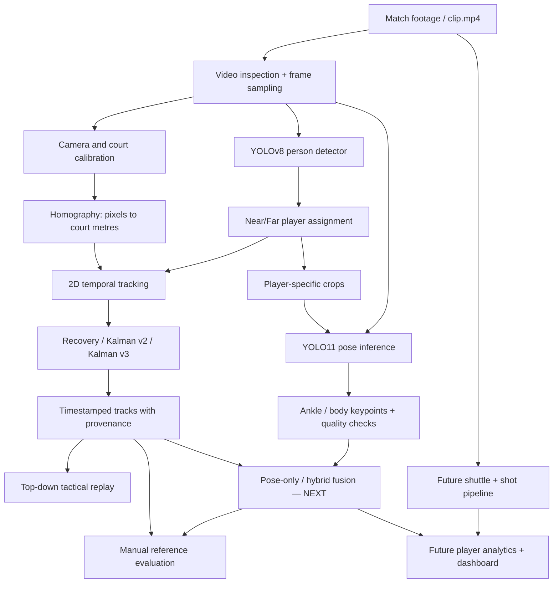
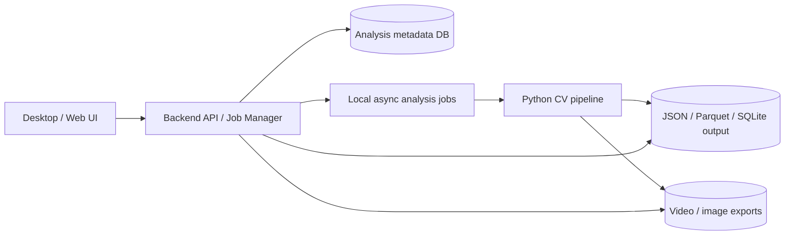

# BADMINTON AI
## Computer Vision, Player Tracking, Pose Estimation & Tactical Match Analytics

**Complete Project Dossier • Technical History • Experiment Log • File Inventory • Long-Term Roadmap**  
**Project stage:** Working research prototype; player tracking and pose-fusion experiments in progress  
**Last updated:** 7 November 2026  
**Primary workspace:** `C:\Users\User\badminton-ai` (Windows 11, VS Code)  
**Prepared for:** Project demonstrations, portfolio presentations, technical handoffs, and continued development

> **One-sentence pitch:** Build an accessible, AI-powered badminton analysis platform that turns ordinary match footage into calibrated player and shuttle tracking, tactical court replays, movement statistics, shot analysis, and actionable coaching insights.
>
> **Status convention throughout this document:** **DONE / TESTED** means it was built and run in our work together; **EXPERIMENTAL** means it works on the limited tested clip but is not yet robust; **NEXT / PROPOSED** means it has been designed or discussed but has not been verified as implemented. This distinction is essential when presenting the project.

---

# 1. Executive Summary

Badminton AI is a self-directed computer-vision and machine-learning project intended first for personal use, teammates and friends, and potentially university training and broader badminton analysis. The idea is to analyze elevated-court or broadcast videos using largely free, publicly available, and locally executable models. Rather than relying on expensive tracking installations or hand-entered statistics, it aims to extract useful movement and tactical information from video.

The initial development deliberately focused on **one stable three-second rally segment** so we could understand every stage of the pipeline: inspecting frames, calibrating the physical court, detecting players, tracking them through motion, generating a tactical animation, measuring tracking error, and investigating pose estimation.

**What already works in the prototype:**

- Reading and sampling a badminton video with OpenCV.
- Mapping image coordinates to an approximate badminton court measured in metres using a perspective homography.
- Detecting the two players with a pretrained YOLOv8n ONNX detector.
- Producing a stylized 2D top-down tactical court view and replay videos.
- Tracking Near and Far players at 10 sampled frames per second through the selected three-second clip.
- Recovering dropped player positions via low-confidence detections and interpolation.
- Using a Kalman filter to smooth and predict player motion.
- Separating **visual body tracking in image pixels** from **ground-position tracking in court metres** in Kalman v3.
- Collecting 22 manually annotated reference frames and comparing trackers quantitatively.
- Running pretrained YOLO11 pose models and testing whether ankle landmarks improve foot-position estimates.
- Demonstrating that cropping a distant player before pose inference substantially improves pose detection coverage over the full-frame approach.

**Key measured outcomes on the current 22-frame annotation set:**

| Algorithm | Visible-foot reference mean error | Near-player mean | Far-player mean | Visible reference coverage |
|---|---:|---:|---:|---:|
| Recovered/interpolated baseline | **0.521 m** | 0.407 m | **0.662 m** | 38/38 |
| Kalman v2 | 0.552 m | 0.382 m | 0.762 m | 38/38 |
| Kalman v3, corrected movement gate | 0.529 m | **0.369 m** | 0.726 m | 38/38 |

These are **mean distances to manually chosen reference points**, not independently certified physical accuracy. This one short clip and these annotations are not a generalization benchmark. The tracker performance is still a prototype-level result, not a finished sports analytics product.

**Most important pose finding:** With cropped **YOLO11n-Pose**, the Near player was matched in 8/8 selected test frames, and the Far player in 5/8; where the pose was matched, ankle midpoints sometimes substantially outperformed bounding-box foot approximations. In the eight Near-player test frames, mean midpoint error was **0.246 m** versus **0.433 m** for YOLO box bottoms. However, the pose model can fail or produce incorrect landmarks, especially for small distant players.

**Immediate next action:** Run `test_pose_fusion.py` (already proposed and supplied in the conversation), compare pose-only and hybrid outputs with the existing 22-frame evaluator, inspect rejections and failure cases, and then decide whether/how to integrate pose measurements into a stateful Kalman v4. **The fusion experiment has not yet been shown running.**

---

# 2. Vision, Audience, and Product Philosophy

## 2.1 The problem

Badminton match analysis is traditionally manual or supported by specialized data collection. Even an apparently simple metric such as “distance covered” requires robust detection, identity assignment, court calibration, continuous tracking, and handling of occlusions, jumps, and camera transitions. Shot recognition introduces the additional challenge of detecting a very small, fast-moving shuttlecock.

The long-term opportunity is a tool that extracts evidence from footage and makes it available to players and coaches in a more intuitive form.

## 2.2 Who it is for

1. **Personal learning:** practice computer vision, tracking, geometry, machine learning, evaluation, and production engineering through a real project.
2. **The developer as a badminton player:** assess training, singles and doubles movement, footwork, consistency, and positioning.
3. **Friends, teammates, and university players:** review matches, compare movement patterns, and discover opportunities to improve.
4. **Potential future users:** coaches, clubs, independent trainers, and badminton communities, if the system becomes sufficiently reliable.

## 2.3 Long-term user experience

A player opens the web application, uploads a match (or selects an existing session), and sees:

- A video player synchronized with a 2D court animation.
- Identified players, rally boundaries, and a navigable match timeline.
- Shot events, shuttle trajectories, shot types, and rally outcomes where defensible.
- Movement maps, average and peak speeds, court zones, work/rest periods, and recovery paths.
- Footwork and pose indicators such as lunges, jumps, stance, direction changes, and possible split steps.
- Analytics by rally, player, set/game, match, and longer-term history.
- Evidence-based coaching explanations linked to actual video timestamps.
- Potentially a carefully qualified pseudo-3D view, with uncertainty shown when 3D depth/height cannot be recovered from the camera.

## 2.4 Guiding principles

- **Learn the fundamentals, don't blindly assemble black boxes.** Each module is implemented and tested in understandable stages.
- **Free-first and local-first.** Prefer free/open technologies, pretrained weights, and offline processing on existing hardware; avoid expensive APIs and paid infrastructure during research.
- **Start with simple, inspectable prototypes.** A three-second rally is a better initial debugging target than an entire tournament recording.
- **Preserve working versions.** New experiments write separate scripts and outputs instead of overwriting validated baselines.
- **Measure improvement.** A visually smoother path is not proof of more accurate tracking.
- **Separate what is observed from what is inferred.** The model can see a jumping player while the exact floor position beneath them remains uncertain.
- **Never present guessed positions or generated tactical views as ground truth.** Keep prediction source, confidence, and uncertainty explicit.
- **Aim for reusable modules.** Detection, geometry, tracking, annotation, analysis, rendering, and dashboard should ultimately be independently testable components.

---

# 3. Current Environment, Hardware, and Technical Stack

## 3.1 Development machine and constraints

| Item | Known setup |
|---|---|
| OS | Windows 11 |
| Editor | Visual Studio Code |
| Project location | `C:\Users\User\badminton-ai` |
| Python | Python 3.12; venv observed as Python 3.12.10 |
| Virtual environment | `.venv` |
| CPU | Intel Core i7-10510U |
| GPU | NVIDIA GeForce MX330, 2 GB VRAM |
| RAM | 16 GB |
| Storage | Limited spare storage was a consideration, so avoid massive downloads and unnecessary video intermediates |
| Initial inference | Primarily CPU, including OpenCV DNN and Ultralytics pose |
| Processing pattern | Offline/batch inference, not real-time streaming |

The hardware is capable of this small-clip experiment but motivates small models, batched/cached data, and short tests. The system has **not** been established as a real-time full-match analyzer on this laptop.

## 3.2 Libraries, frameworks, models, and formats

| Technology | Role | Status |
|---|---|---|
| Python 3.12 | Main prototyping and pipeline language | Installed, used |
| OpenCV (`cv2`) | Video I/O, image processing, coordinate transforms, drawing, ONNX inference, Kalman filters | Used; OpenCV 5.0.0 recorded |
| NumPy | Matrix and array operations | Used; NumPy 2.5.4 recorded |
| YOLOv8n, ONNX | Initial pretrained human detection | Used as `models/yolov8n.onnx` |
| Ultralytics | Pose model loading and inference | Installed and used |
| PyTorch | Ultralytics inference dependency | Installed via dependencies; specific installed version not recorded |
| `yolo11n-pose.pt` | 17-keypoint lightweight pose estimation | Tested, currently preferred for this clip |
| `yolo11s-pose.pt` | Larger pose-model comparison | Tested, worse in tested Far-player examples |
| JSON | Calibration, detections, tracks, manual labels, diagnostics | Used |
| CSV | Numeric comparisons, experiment outputs | Used |
| MP4 | Source video and rendered replays | Used |
| JPEG/PNG | Diagnostic frames, collages, court renderings | Used |
| PowerShell | Local command-line workflow | Used |
| Web framework / backend | Future interactive dashboard | Not implemented for this project |
| Shuttle-specific model | Future shuttle localization | Not implemented |
| Trainable custom ground-contact model | Potential later upgrade | Not implemented |

The pose models were downloaded automatically by Ultralytics during the experiments: `yolo11n-pose.pt` (approximately 6.0 MB in the logged download) and `yolo11s-pose.pt` (approximately 19.4 MB). Sizes describe the observed downloads, not a general version guarantee.

---

# 4. Input Footage and Experimental Scope

## 4.1 Source

- Working video in the project: `data/raw/clip.mp4`.
- Source described in conversation as **Finebadminton 20K**, an elevated/broadcast badminton recording.
- Resolution: **1280 × 720**.
- Frame rate: **25 FPS**.
- Total frames: **7,616**.
- Full duration: **304.64 seconds**, approximately 5 minutes 4.6 seconds.
- Recorded full video includes highlights/cuts, so the first implementation does **not** assume the whole clip is a single static camera scene.

## 4.2 Chosen development window

- Start: **20.0 s**.
- End: **23.0 s** (exclusive for the 30-sample extraction).
- Duration: **3.0 seconds**.
- Inference sampling rate: **10 FPS**.
- Number of sampled instants: **30**.
- Tactical/review video frame rate: **25 FPS**.
- Rendered video frames for this segment: **75**.

**Why this window?** It contains a stable elevated view, both players, fast near-player lunging, and a far-player jump that creates a deliberately challenging tracking failure. It provides a manageable end-to-end case study.

**Important distinction:** A 75-frame replay derived from 30 sampled measurements includes temporal interpolation or smoothing. It does **not** mean the detector ran 75 independent inferences.

## 4.3 Court geometry used

- Doubles court width: **6.10 m**.
- Full court length: **13.40 m**.
- Net/halfway coordinate: **court Y = 6.70 m**.
- Singles sidelines: approximately **X = 0.46 m and 5.64 m**.
- Service/boundary coordinates used in the renderer included **Y = 0.76, 4.72, 8.68, and 12.64 m**.
- Naming convention: Near player is in the bottom camera half / near court; Far player is beyond the net.

The project uses a simplified top-down `(x, y)` court coordinate system. Near/Far labels are camera-relative, not persistent real-world athlete identities.

---

# 5. Architecture — What the Pipeline Does



**Current architecture detail:** The proposed v4 fusion script is initially **post-processing**, not yet a new end-to-end online Kalman tracker. It reads the v3 tracks, calls pose estimation, and writes alternative `court_m` values for comparison. A genuine stateful v4 would feed validated pose measurements into filter updates and manage its own uncertainty over time.

---

# 6. Chronological Development Log — Everything Implemented and Tested

The timeline below reconstructs the major development stages from our conversation and the existing output artifacts. Some of the earliest prototype scripts were not uploaded as source files, so their responsibilities are recorded from the work history, not re-audited line by line.

## Stage A — Local project foundation [DONE]

**Goal:** Start a reproducible computer vision workspace on modest hardware.

Work completed:

1. Created the `badminton-ai` project in VS Code on Windows.
2. Selected Python 3.12 instead of trying to build everything as a web app at the outset.
3. Created and activated `.venv`.
4. Installed OpenCV and NumPy.
5. Prepared `data/raw`, `outputs`, and `models` folders.
6. Committed conceptually to offline, small-clip processing before any cloud or production architecture.

**Learning:** isolated environments, Python dependencies, image arrays, frame access, model runtime choices, hardware constraints.

## Stage B — Video inspection and sample-frame extraction [DONE]

**Scripts:** `inspect_video.py`, `sample_frames.py`.

- Inspected resolution, frame rate, frame count, and duration.
- Extracted representative frames / sample contactsheets to understand camera viewpoint.
- Selected the stable scene at approximately 20 s and ultimately the 20–23 s segment.
- Produced early visual artifacts such as `first_frame.jpg`, `sample_frames.jpg`, and `contact_sheet.jpg`.

**Learning:** videos are timestamped frame sequences; sampling time and decoding frame number must remain consistent; scene cuts can invalidate tracking assumptions.

## Stage C — Manual court calibration [DONE, camera-specific]

**Scripts:** `mark_court.py`, `court_transform.py`.

- Chose four image coordinates on the visible near court.
- Saved the clicked points to `outputs/court_points.json`.
- Created the image-to-court projective homography.
- Tested the projected view and alignment, including a reference check around **8.67 m versus 8.68 m** in the earlier setup discussion.
- Produced `calibration_frame.jpg`, `warp_test.jpg`, `court_topdown.jpg` and related visual evidence.

The stored image coordinates, in the same order as the corresponding court coordinates, are:

```json
[
  [217, 630],
  [1067, 631],
  [945, 414],
  [337, 415]
]
```

Mapped to metres:

```python
[
    [0.0, 0.0],
    [6.10, 0.0],
    [6.10, 4.72],
    [0.0, 4.72],
]
```

OpenCV builds the transform with `cv2.getPerspectiveTransform`. A video image coordinate `(u,v)` is projected to a court coordinate `(x,y)` by homogeneous matrix multiplication and division by the homogeneous scale.

**Geometric limitation:** A homography maps **points on a single plane**. It is valid for shoe-to-floor contact locations under fixed-camera assumptions. It is **not a 3D reconstruction**, and it does not directly locate a player in court space when their feet are airborne. The far half is inferred by extending the court plane transformation beyond the four near-court calibration points, so far-player calibration should eventually be independently validated.

## Stage D — Synthetic tactical court renderer [DONE]

**Script:** `tactical_view.py` and subsequent replay/rendering scripts.

- Drew a clean stylized top-down badminton court using physical dimensions.
- Used white boundary/service lines and net geometry with a green playing area.
- Added player markers (Near cyan, Far gold) and a dark/premium tactical/replay presentation.
- Created early court-view images such as `tactical_view.jpg` and later iterations.

**Learning:** physical units, coordinate conventions, offscreen rendering, graphics layers, and the difference between a synthetic schematic court and an image-warped camera view.

## Stage E — First manual player positions [DONE]

**Script:** `mark_players.py`.

- Clicked representative Near/Far points in the source image.
- Stored their image pixel coordinates and projected court locations in `player_positions.json`.
- Established an initial manual reference for checking YOLO detection.

Example initial positions from the saved file:

| Player | Manually clicked pixel | Projected court coordinate |
|---|---|---|
| Near | `(727, 497)` | approximately `(3.809, 2.531) m` |
| Far | `(713, 268)` | approximately `(4.053, 10.836) m` |

These original manual positions predate the more systematic 22-frame evaluation dataset.

## Stage F — YOLOv8 person detection [DONE]

**Script:** `detect_players.py`.

- Loaded the pretrained `models/yolov8n.onnx` with OpenCV DNN.
- Ran inference on the source frames.
- Filtered detections to the **person** class.
- Used detector confidence and nonmaximum suppression (NMS).
- Approximated the player's ground point using the **bottom-center of the person bounding box**.
- Converted that pixel to court metres through the homography.
- Assigned a Near and Far player using image/court position constraints.
- Produced the detection images and initial `auto_players.json` output.

At 20.0 s, the automatic detections in the stored artifact were approximately:

| Side | Detector confidence | YOLO image foot | Court point |
|---|---:|---|---|
| Near | ~0.872 | `(724, 509)` | `(3.769, 2.260) m` |
| Far | ~0.598 | `(710.5, 273)` | `(4.007, 10.554) m` |

Compared with the earlier manual clicks, the initial discrepancies were approximately **0.274 m** (Near) and **0.286 m** (Far).

**Learning:** model inference output parsing, class confidence, bounding boxes, IoU/NMS, homography, and errors introduced by proxy ground points.

## Stage G — First tracking sequence and tactical replay [DONE]

**Script:** `track_video.py`, with an early 2D replay script later evolved into `smooth_replay.py`.

- Sampled the stable 20–23 s window at 10 Hz.
- Applied the same detector per sample and tried to keep Near and Far identities.
- Recorded timestamp, source frame index, confidence, pixel point, and court location.
- Wrote a tracking JSON sample (`tracking_sample.json`, later 30-sample versions).
- Generated first tactical replay MP4 files and checked timing/visual alignment against the broadcast footage.
- Created contact sheets and still frames for spot checks.

**Initial failure:** the tracking data contained gaps despite the two visible players still existing in the video. This was the entry point for recovery logic, prediction, and explicit tracking-source labels.

## Stage H — Smoothing, synchronization, and replay QA [DONE]

**Scripts:** `smooth_replay.py`, `sync_review.py`, plus frame/collage inspection utilities.

- Smoothed raw position sequences using median/Gaussian-style smoothing and gap interpolation.
- Upsampled the 30 sampled positions to 75 video frames for a 25 FPS 3-second tactical clip.
- Compared original and tactical views in a synchronized review video.
- Inspected frame-by-frame screenshots to identify teleporting markers, lag, and discontinuities.
- Generated `smooth_tactical_replay.mp4`, `synchronized_review.mp4`, numerous `replay_frame_*.jpg` and `replaycheck_*.jpg` visual checks.

**Lesson:** presentation-quality smoothing is useful, but it can hide measurement uncertainty and may lag rapid changes. Smoothing and tracking accuracy are separate concerns.

## Stage I — Diagnosis of lost player positions [DONE]

**Script:** `debug_detections.py`.

The root causes of two failures were different:

**Near player at 21.7 s — confidence rejection:**

- YOLO detected the lunging person at confidence **0.314856**.
- The earlier normal detection threshold was **0.35**.
- The detection itself was valid and on court; it was simply filtered out too aggressively.

**Far player at 22.3–22.8 s — geometry rejection:**

- YOLO still detected the player's body during their jump.
- Bottom-of-box image points projected to `court Y` outside the valid **13.40 m** boundary.
- Examples of rejected court-Y values: **13.615, 13.907, 15.561, 15.816, 13.407, 13.625 m**.
- The player did not disappear; the assumed bbox-foot-to-ground mapping became invalid because the player was airborne.

**Crucial conceptual discovery:** **Visual detection success ≠ valid ground-position measurement.** Don't clamp an invalid airborne projection to a court boundary and claim it is measured.

## Stage J — Recovered/interpolated tracker [DONE]

**Script:** `recover_tracking.py`.

- Recovered the Near-player position at 21.7 s by accepting the lower-confidence ~0.315 detection.
- Filled the six missing far-ground positions from 22.3 through 22.8 s by **interpolating between surrounding known samples** at 22.2 and 22.9 s.
- Recorded origin tags such as `measured`, `low_confidence`, and `interpolated`.
- Output: `outputs/tracking_recovered.json`.
- Rendered `outputs/recovered_tactical_replay.mp4`.
- Created a manually inspectable annotated `tracking_collage.jpg` showing status per player/frame.

The stored recovered dataset contains **30 samples**, **29 Near measured + 1 Near low confidence**, **24 Far measured + 6 Far interpolated**, with **60/60 populated positions**.

**Important:** this recovery uses future timestamps when interpolating an earlier gap. That can be appropriate for **offline replay**, but it is not an online/real-time tracker.

## Stage K — Kalman v2: predictive court-space tracking [DONE]

**Script:** `track_players_v2.py`.

- Built a separate per-player constant-velocity Kalman filter in court metres.
- State: `(x, y, vx, vy)`.
- Used looser detector confidence for candidate collection, then separate acceptance thresholds.
- Predicted the next position before considering the current detection.
- Accepted valid measurements when possible; used prediction when detections failed the court gate.
- Saved source labels including `measured`, `low_confidence`, `predicted`, and `predicted_from_track`.
- Output: `tracking_kalman.json` and `kalman_tactical_replay.mp4`.

In the existing 30-frame artifact: **Near 29 measured + 1 low confidence; Far 23 measured, 6 predicted, 1 predicted_from_track; 60/60 positions populated**.

**Key comparison:** In the airborne gap, offline interpolation and forward-only Kalman prediction disagreed substantially (about **0.525 m** around 22.6 s in the comparison review). This disagreement motivated formal manual annotation and error measurement instead of choosing by eye.

## Stage L — Side-by-side tracker review [DONE]

**Script:** `compare_trackers.py`.

- Created a three-panel `tracker_comparison.mp4`: original video, recovered tactical court, Kalman tactical court.
- Approximate output format was 1600 × 760 with the original frame at left and two court panels alongside.
- Extracted stills at several output frames for investigation.
- Observed that interpolation, prediction, and filtering produce different court trajectories, especially when the far player jumps.

This was a visualization experiment, not a quantitative evaluation by itself.

## Stage M — Manual ground-position annotation [DONE]

**Script:** `annotate_players.py`.

Created a small OpenCV annotation interface:

- Shows a source frame and schematic court side by side.
- Keys `1` / `2` choose Near/Far.
- Clicking the video creates a ground-contact image pixel reference and maps it to court metres.
- Clicking the tactical court creates a subjective `estimated_ground_position` for an airborne player.
- `X` marks `uncertain_skipped` where no defensible reference can be given.
- `N` / `B` navigate reference timestamps; `R` resets; `Q` saves and exits.
- Existing saved annotations reload, allowing expansion without losing prior work.

**Initial annotation set:** 6 timestamps (21.7, 22.2, 22.4, 22.6, 22.8, 22.9 s): 9 visible contacts and 3 estimated airborne positions.

**Expanded annotation set:** 22 timestamps from 20.0 to 22.9 s: **38 visible-foot reference labels, 5 estimated airborne ground positions, and 1 explicitly skipped/uncertain Near position at 21.2 s**. Total 44 potential player/frame slots, 43 numeric reference points.

The expanded timestamp list:

```python
[
    20.0, 20.2, 20.4, 20.6, 20.8,
    21.0, 21.2, 21.4,
    21.5, 21.6, 21.7, 21.8,
    22.0, 22.1, 22.2, 22.3,
    22.4, 22.5, 22.6, 22.7,
    22.8, 22.9
]
```

**Annotation guidance used:** midpoint between shoe contact locations when both feet are grounded; the grounded shoe when only one is touching; an explicitly uncertain court estimate when airborne; skip if genuinely impossible to determine. **Interpretation caution:** these choices must be made consistently and can differ from a bounding-box bottom-center or ankle midpoint. Re-review ambiguous frames, particularly far-player contact near 22.3 s and previously noted ~1 m discrepancies around 21.7/22.2 s.

## Stage N — Formal tracker evaluation [DONE]

**Script:** `evaluate_trackers.py`.

- Loads `outputs/manual_evaluation.json` and each configured tracker JSON.
- Computes Euclidean ground-coordinate distance in metres between prediction and reference.
- Reports mean, median, maximum, coverage, and a diagnostic proportion within 0.50 m.
- Separates visible-contact references from subjective airborne estimates.
- Separates Near and Far players to expose perspective and model asymmetry.
- Saves `outputs/evaluation/tracker_errors.csv` and `evaluation_summary.json`.
- Expanded from two trackers to three, and is designed to accept additional v4 trackers.

Evaluation uses **the same reference dataset** for all compared algorithms. It currently does not test model generalization on an independent video.

## Stage O — Kalman v3: dual-space tracking [DONE, EXPERIMENTAL]

**Script:** `track_players_v3.py`.

Core upgrade: **two Kalman filters per player**.

1. **Image-space Kalman:** body center `(u, v)` and pixel velocity, used to associate visible YOLO detections—even when the player jumps.
2. **Court-space Kalman:** estimated floor point `(x, y)` and velocity, updated only when the foot-derived court measurement passes quality checks.

Implemented features:

- YOLOv8n ONNX inference on the 30 sampled frames.
- Image-space detection association using distance from the predicted body center.
- Separate Near/Far tracks.
- Court bounds and movement gate for rejecting implausible ground updates.
- `visual_detection`, `ground_updated`, `ground_age_seconds`, `image_center`, `raw_court_m`, `court_m`, confidence, bbox, and `position_source` fields.
- Stop trusting indefinitely old unsupported court estimates using a max-age threshold.

### The v3 lockout bug and correction

First test used `MAX_COURT_UPDATE = 1.20` m. At 21.9–22.2 s, far-player observations were rejected because the filter prediction had drifted, even though several raw observations looked plausible. After too many rejected measurements, the estimated ground point became stale and unavailable at 22.6–22.9 s.

We ran a controlled experiment increasing the gate to **1.80 m**, then reran the evaluator.

Observed after changing the gate:

- Far-player ground updates resumed at **21.9, 22.0, 22.1, 22.2 s**.
- Jump-period detections remained visible at **22.3–22.8 s**, while unreliable ground projections were rejected.
- Valid far-player ground update resumed at **22.9 s**.
- Both players had a tracked body detection and court position at all **30 sampled times** (60/60 slots) in this specific output.

**Known risk:** A larger gate can accidentally admit incorrect measurements. Future adaptive gating and reacquisition should replace a one-size-fits-all 1.80 m threshold.

## Stage P — Foot-location error visualization [DONE]

**Script:** `inspect_foot_errors.py`.

- Produced `outputs/evaluation/foot_error_collage.jpg` across selected timestamps.
- Overlaid green YOLO boxes, pink bounding-box bottom-center feet, and cyan manual reference points.
- Showed discrepancies in **original-video pixels**, before resizing thumbnails.
- Examples: at 21.4 s the Near player's bounding box is very wide during a lunge; the bottom-center point can deviate significantly from true shoe contact. During far-player jump, the bbox bottom is airborne, not a floor-contact measurement.

The image provided evidence to investigate a more anatomically meaningful location estimator rather than only tuning the Kalman smoother.

## Stage Q — Full-frame pose detection [DONE]

**Script:** `detect_pose.py`.

- Installed Ultralytics and its dependencies.
- Downloaded and tested `yolo11n-pose.pt`.
- Used the standard 17-keypoint COCO pose layout (wrists, elbows, shoulders, hips, knees, ankles, etc.).
- Drew stick-figure skeletons on 8 selected rally frames.
- Compared YOLO bbox foot, both-ankle midpoint, image-lower ankle, and an *oracle* best ankle against manual reference positions.
- Produced `outputs/pose/pose_collage.jpg` and `pose_comparison.csv`.

**Results:** Near player matched 8/8; Far player only 1/8 with full-frame pose inference. Near-player box-point mean **0.433 m**, ankle midpoint mean **0.260 m**, across those eight frames. The full-frame model was inadequate for consistently resolving the distant player.

**Research warning:** The “best ankle oracle” uses manual reference error to choose a pose candidate; it is **not a deployable algorithm**. A real tracker cannot peek at ground truth.

## Stage R — Cropped pose inference, Nano vs Small [DONE]

**Script:** `detect_pose_cropped.py`.

**Design:** Use the existing tracked YOLO bbox to crop each player, enlarge the relative body scale seen by the pose network, match a returned pose back to the original bbox using IoU, then transform ankle keypoints back into original-video pixels and court metres.

Crop settings discussed/tested: horizontal scale about **1.8×**, vertical scale **1.5×**, minimum crop about 80 × 100 original pixels; output stays associated with Near/Far via the previous tracker.

**Experiment 1 — YOLO11n-Pose, cropped, `imgsz=640`:**

- Near pose matched **8/8**, ankles detected on all matched Near samples.
- Far pose matched **5/8**; failed at **22.4, 22.6 and 22.9 s**.
- Near ankle-midpoint mean error **0.246 m** (8 frames) versus Near bbox-foot mean **0.433 m**.
- Far ankle-midpoint mean error **0.380 m** on its **5 matched** frames.
- Important useful examples: far at 20.6 s bbox **0.907 m** vs midpoint **0.190 m**; far at 21.7 s bbox **1.030 m** vs midpoint **0.117 m**; far at 22.2 s bbox **1.041 m** vs midpoint **0.358 m**.
- Not universal: far at 20.0 s bbox **0.257 m** versus pose **0.593 m**; 21.4 s bbox **0.094 m** versus pose **0.644 m**.

**Experiment 2 — YOLO11s-Pose, cropped, `imgsz=960`:**

- Near pose matched **8/8**; ankle midpoint mean **0.257 m**.
- Far matched **3/8** only; average midpoint error **2.245 m** on those three matched frames, including severe errors of **3.625 m at 20.0 s** and **2.169 m at 21.7 s**.
- Several suspect far matches had low pose-to-original-bbox overlap (e.g. IoU about 0.288 at 20.0 s, 0.343 at 21.7 s), indicating possible wrong-person assignment, poor landmark position, or both.

**Current decision:** Prefer **cropped YOLO11n-Pose** for this limited experiment, not the larger `11s` model. More parameters and resolution did not guarantee better distant-player results.

## Stage S — Proposed pose-fusion v4 prototype [NEXT; NOT YET VERIFIED]

**Script supplied but not yet shown running:** `test_pose_fusion.py`.

Proposed experiment:

- Read the existing `tracking_v3.json` rather than altering v3.
- Run cropped `yolo11n-pose.pt` at the same 30 timestamps.
- Accept a pose ankle midpoint only when: v3 has a current accepted ground update, a relevant bbox and both confident ankles exist, pose box IoU is sufficiently high, the derived court point falls in the appropriate half, and pose/bbox geometry is not wildly inconsistent.
- Produce **pose-only replacement** and **weighted hybrid** positions, each falling back to v3 where pose is rejected.
- Evaluate both against the same 22-frame reference annotations.

Proposed experiment parameters in the supplied script:

```python
MODEL = "yolo11n-pose.pt"
MIN_ANKLE_CONF = 0.40
MIN_POSE_IOU = 0.45
MAX_POSE_BBOX_DISTANCE = 1.50  # metres
POSE_WEIGHT = 0.65
```

Proposed outputs:

- `outputs/tracking_v4_pose.json`
- `outputs/tracking_v4_hybrid.json`
- `outputs/pose/fusion_diagnostics.json`

**Critical interpretation:** `ground_updated=True` from v3 does not *prove* two shoes are in ground contact. Neither confidence, IoU, nor a fixed blend automatically makes a pose accurate. A fair next analysis must inspect false acceptances as well as average error. If the fusion prototype helps, then build a **true stateful Kalman v4** with pose-derived measurements, uncertainties, adaptive filtering, and tracked identity maintenance.

---
# 7. Detailed Source File Inventory

This is a **reconstructed file catalog** from our working conversation and uploaded artifacts. The names below are the project's intended/local names. Some uploaded copies have suffixes like `(1)` or `(2)` because the same file was shared more than once; those suffixes should **not** be treated as separate designed source files or official versions.

## 7.1 Python scripts — existing or previously executed

| File | Purpose | Status / notes |
|---|---|---|
| `inspect_video.py` | Read source video metadata: FPS, dimensions, frames, duration. | **DONE** in early setup. |
| `sample_frames.py` | Export sample frames/contact views for inspecting rallies and camera angle. | **DONE**. |
| `mark_court.py` | Interactively choose court image points and save calibration coordinates. | **DONE**; manual calibration. |
| `court_transform.py` | Compute/test perspective homography and map image points to physical court dimensions. | **DONE**. |
| `tactical_view.py` | Draw schematic top-down badminton court, with actual field dimensions and player markers. | **DONE**. |
| `mark_players.py` | Manually click and save initial Near/Far reference positions. | **DONE**. |
| `detect_players.py` | Detect persons using OpenCV DNN + YOLOv8n ONNX and project bbox-foot point to court. | **DONE**. |
| `track_video.py` | Apply initial player detection at time samples and save timestamped Near/Far tracks. | **DONE**. |
| `smooth_replay.py` | Smooth/interpolate tracking positions and create a 25 FPS tactical replay video. | **DONE**; later reused with recovered and Kalman data. |
| `sync_review.py` | Align original video and tactical court animation for side-by-side timing checks. | **DONE**. |
| `debug_detections.py` | Inspect all candidate detections and explain rejections by confidence/court geometry. | **DONE**. |
| `recover_tracking.py` | Recover lower-confidence Near detection and interpolate Far ground-position gaps. | **DONE**. |
| `make_tracking_collage.py` | Produce annotated contact sheet with measured/recovered/predicted status markers. | **DONE**. |
| `track_players_v2.py` | First per-side, court-space constant-velocity Kalman tracking experiment. | **DONE**. |
| `compare_trackers.py` | Video comparison: source, recovered track, Kalman track. | **DONE**. |
| `annotate_players.py` | OpenCV GUI for manual ground reference labeling with uncertainty/skip distinctions. | **DONE**; expanded to 22 reference times. |
| `evaluate_trackers.py` | Compute tracker-to-reference errors and export summary JSON and per-sample CSV. | **DONE**; evaluated baseline, v2 and v3. |
| `track_players_v3.py` | YOLO body detector with separate image-space and court-space Kalman filters. | **DONE / EXPERIMENTAL**; movement gate increased from 1.20 to 1.80 m. |
| `inspect_foot_errors.py` | Show bbox, YOLO proxy foot, and manual shoe points to diagnose localization errors. | **DONE**. |
| `detect_pose.py` | Test full-frame YOLO11n-Pose skeleton/ankle detection and compare to manual references. | **DONE**. |
| `detect_pose_cropped.py` | Run pose inference separately on person crops, associate by IoU, test Nano and Small variants. | **DONE**; two different experiment settings executed. |
| `test_pose_fusion.py` | Proposed post-processing fusion of v3 and trusted cropped ankle midpoints. | **NEXT**; code supplied, execution not yet confirmed. |

**Potential future source modules** (design recommendations, not created yet): `video_io.py`, `calibration.py`, `detectors/person.py`, `detectors/shuttle.py`, `pose/landmarks.py`, `tracking/kalman.py`, `tracking/association.py`, `tracking/fusion.py`, `rallies/segmenter.py`, `shots/classifier.py`, `analytics/movement.py`, `rendering/replay.py`, `evaluation/metrics.py`, `api/`, and `web/`. This is a refactoring target, not the existing repository layout.

## 7.2 Primary input, model, and data files

| Path or filename | Description | Status |
|---|---|---|
| `data/raw/clip.mp4` | Source badminton match/highlights recording. | **USED**; 1280×720, 25 FPS, 304.64 s. |
| `models/yolov8n.onnx` | Pretrained YOLOv8 nano detector imported by OpenCV DNN. | **USED**. |
| `yolo11n-pose.pt` | Ultralytics lightweight pose checkpoint; may live at project root after automatic download. | **USED**, preferable pose baseline in current tests. |
| `yolo11s-pose.pt` | Larger Ultralytics pose checkpoint. | **USED** for comparison; not selected as current default. |
| `outputs/court_points.json` | Four calibrated image corner coordinates. | **CREATED / USED**. |
| `outputs/player_positions.json` | Two original manual player points and court projections. | **CREATED / USED**. |
| `outputs/auto_players.json` | Detected players at initial reference frame, with bbox and confidence. | **CREATED / USED**. |
| `outputs/tracking_sample.json` | Early source tracks; some snapshots show a shorter 6-frame preview. | **CREATED**; later 30-frame runs are the main basis. |
| `outputs/tracking_recovered.json` | 30-frame tracking with gap interpolation and provenance. | **CREATED / EVALUATED**. |
| `outputs/tracking_kalman.json` | 30-frame Kalman v2 tracking and prediction origins. | **CREATED / EVALUATED**. |
| `outputs/tracking_v3.json` | Dual-space Kalman v3; latest tested version uses 1.80 m gate. | **CREATED / EVALUATED**. |
| `outputs/manual_evaluation.json` | Main 22-timestamp, 44-slot reference label set. | **CREATED / EVALUATED**. |
| `outputs/manual_evaluation_backup.json` | Recommended backup of manual references before expanding labels. | **COMMAND GIVEN**; existence on PC not independently confirmed. |
| `outputs/evaluation/tracker_errors.csv` | Long-form comparison table for every tracker and applicable reference. | **CREATED / EVALUATED**. |
| `outputs/evaluation/evaluation_summary.json` | Coverage and error summaries by tracker and reference type. | **CREATED / EVALUATED**. |
| `outputs/pose/pose_comparison.csv` | Full-frame Nano pose vs box / ankle-point metrics. | **CREATED / EVALUATED**. |
| `outputs/pose/cropped_pose_comparison.csv` | Latest cropped pose run; overwritten by Small model after initial Nano run. | **CREATED / EVALUATED**. |
| `outputs/pose/cropped_pose_nano.csv` | Recommended preserved backup of first Nano crop experiment. | **COMMAND GIVEN**; confirm existence on local machine. |
| `outputs/pose/fusion_diagnostics.json` | Planned v4 per-frame pose acceptance, rejection, and geometry details. | **NEXT / NOT CONFIRMED**. |
| `outputs/tracking_v4_pose.json` | Proposed fallback-to-v3 with accepted ankle midpoint replacement. | **NEXT / NOT CONFIRMED**. |
| `outputs/tracking_v4_hybrid.json` | Proposed weighted blend of v3 position and accepted ankle midpoint. | **NEXT / NOT CONFIRMED**. |

## 7.3 Image and video output inventory

The following names were found among uploaded working artifacts or named and discussed during the development session. They are **debug/demo artifacts**, not separate ML models.

### Early inspection and calibration images

| Artifact | Purpose |
|---|---|
| `first_frame.jpg` | Frame inspection / source-video reference. |
| `sample_frames.jpg` | Collection of sampled frames. |
| `contact_sheet.jpg` | Multi-frame visual overview of footage. |
| `calibration_frame.jpg` | Source frame used for court calibration. |
| `warp_test.jpg` | Perspective mapping / court warp check. |
| `court_topdown.jpg` | Court image transformed into a top-down reference. |
| `tactical_view.jpg` and iterated tactical view images | Stylized synthetic court renderings. |
| `detected_people.jpg` | Initial detected-person overlays. |
| `detection_evaluation.jpg` | Initial detected-vs-manual location assessment. |

### Replay and tracking outputs

| Artifact | Purpose |
|---|---|
| `first_tactical_replay.mp4` and subsequent iteration | First animated 2D tactical prototype. |
| `smooth_tactical_replay.mp4` | Temporally smoothed/interpolated tactical view. |
| `recovered_tactical_replay.mp4` | Replay generated from recovered/interpolated tracks. |
| `kalman_tactical_replay.mp4` | Replay generated from Kalman v2 tracking. |
| `synchronized_review.mp4` | Source broadcast plus tactical synchronization review. |
| `tracker_comparison.mp4` | Source broadcast, recovered, and Kalman comparison. |
| `tracking_collage.jpg` | Sampled video frames with player position source/type overlays. |
| `replay_contact.jpg` | Contact-sheet review of replay frames. |
| `replay_frame_*.jpg` | Frame-level rendered replay checks. |
| `replaycheck_*.jpg` | Additional timestamp/frame alignment diagnostics. |
| `recovered_check_*.jpg` | Recovered trajectory frame inspection. |
| `smooth_frame_check.jpg` | Smoothed output sanity check. |
| `sync_lastframes.jpg` | Late synchronization-frame comparison. |
| `foot_error_collage.jpg` | Bounding-box feet vs manual shoe-contact difference visualization. |

### Pose estimation outputs

| Artifact | Purpose |
|---|---|
| `outputs/pose/pose_collage.jpg` | Full-frame Nano pose skeletons and foot markers. |
| `outputs/pose/pose_comparison.csv` | Full-frame pose diagnostics and error. |
| `outputs/pose/cropped_pose_collage.jpg` | Cropped pose skeleton output; last run was Small model unless Nano copy preserved. |
| `outputs/pose/cropped_pose_comparison.csv` | Cropped pose metrics; last run was Small model unless Nano copy preserved. |
| `outputs/pose/cropped_pose_nano.jpg` | Recommended snapshot copy of Nano collage prior to running Small. |
| `outputs/pose/cropped_pose_nano.csv` | Recommended snapshot copy of Nano metrics prior to running Small. |

**Portability tip:** To show any of these images inside a Markdown viewer, keep the `.md` file in the `badminton-ai` root and use project-relative image links such as ``. The dossier itself remains readable if an artifact is absent. Do not mistake copies in a chat attachment folder for guaranteed files in the local project tree.

## 7.4 Proposed directory organization for the next refactor

The current project grew organically as independent learning scripts. A clean future structure might be:

```text
badminton-ai/
├─ README.md
├─ BADMINTON_AI_PROJECT_DOSSIER.md
├─ .venv/                         # local virtual environment; don't commit
├─ requirements.txt              # PROPOSED dependency manifest
├─ models/
│  ├─ yolov8n.onnx
│  ├─ yolo11n-pose.pt              # recommended to move/checkpoint here later
│  └─ ...
├─ data/
│  ├─ raw/
│  │  └─ clip.mp4
│  ├─ annotations/                # PROPOSED organized labels
│  └─ samples/                    # PROPOSED independent rallies
├─ outputs/
│  ├─ court_points.json
│  ├─ tracking_recovered.json
│  ├─ tracking_kalman.json
│  ├─ tracking_v3.json
│  ├─ manual_evaluation.json
│  ├─ pose/
│  ├─ evaluation/
│  ├─ collages/
│  └─ ... tactical renders and review MP4s
├─ inspect_video.py
├─ sample_frames.py
├─ mark_court.py
├─ court_transform.py
├─ tactical_view.py
├─ mark_players.py
├─ detect_players.py
├─ track_video.py
├─ smooth_replay.py
├─ sync_review.py
├─ debug_detections.py
├─ recover_tracking.py
├─ make_tracking_collage.py
├─ track_players_v2.py
├─ compare_trackers.py
├─ annotate_players.py
├─ evaluate_trackers.py
├─ track_players_v3.py
├─ inspect_foot_errors.py
├─ detect_pose.py
├─ detect_pose_cropped.py
├─ test_pose_fusion.py               # NEXT: provided, not verified run
└─ src/                              # PROPOSED future reusable package
   ├─ video/
   ├─ geometry/
   ├─ detection/
   ├─ pose/
   ├─ tracking/
   ├─ analytics/
   ├─ evaluation/
   └─ rendering/
```

The tree is a **reference organizational plan**, not a verified `dir` listing of the Windows machine; particular generated files may be in slightly different local paths.

---

# 8. Tracking Algorithms and Engineering Decisions

## 8.1 Detection vs localization vs tracking

These problems are related but different:

- **Detection:** Is there a person in the frame? What bounding box surrounds them?
- **Localization:** Which point on the person represents their actual court position?
- **Projection:** Where does that 2D image point map onto the known flat court?
- **Association / identity:** Is this the same person as in the previous frame?
- **Temporal state estimation:** Given noisy measurements and missing observations, where is the player likely to be now?
- **Uncertainty:** What did we directly observe, what did we infer, and how sure are we?

Many of the early errors came from treating all of these as one single problem.

## 8.2 Bounding-box bottom-center proxy

For a person detection stored as `[x, y, width, height]`:

```python
foot_pixel = [x + width / 2, y + height]
```

Advantages: simple, cheap, stable for some upright poses. Disadvantages: shifts with body angle, arm extension, foot spread, jumps, partial detection, and bounding-box shape. For some lunges, this point is in the wrong location even if YOLO detects the correct person perfectly.

## 8.3 Homography

For image point `(u,v)`, court point `(x,y)` is computed by:

```text
[x', y', w']ᵀ = H · [u, v, 1]ᵀ
x = x' / w'
y = y' / w'
```

`H` is a 3 × 3 matrix determined by four 2D-to-2D correspondences. It is **camera-specific** and assumes the mapped point lies on the court plane. It can be reused across a **fixed-camera scene**, but not automatically across cuts/zoom/pan without recalibration or camera-motion compensation.

## 8.4 Constant-velocity Kalman model

Both Kalman v2 and v3 use a four-dimensional constant-velocity state:

```text
state = [x, y, vx, vy]ᵀ
measurement = [x, y]ᵀ

F(dt) = [[1, 0, dt, 0],
         [0, 1, 0, dt],
         [0, 0, 1,  0],
         [0, 0, 0,  1]]
```

At every timestep, the filter predicts a position, looks for a valid observation, and conditionally corrects its state. When a measurement is missing, it continues predicting temporarily.

**Challenge:** Badminton movement is not constant velocity. Split steps, explosive acceleration, pivots, lunges, jumps, and sudden changes of direction can cause overshoot or lag. The filter also depends on appropriate process/measurement uncertainty settings.

## 8.5 Why dual-space tracking was necessary

During a jump, an athlete's **visible body** can be reliably tracked in the 2D image, while the **ground-contact point** is absent or unobservable. If image association depends on an apparently valid court point, the track may vanish even when the player is clearly visible.

v3 therefore:

- Uses image-body centers to associate the same visual player across frames.
- Tracks court position in a separate filter.
- Rejects false/off-court foot projections without losing the visual detection.
- Tags predicted positions and how long it has been since a valid ground update.

This is a foundation for later shot and pose analytics because body motion and court motion can be analyzed separately.

## 8.6 Interpolation vs prediction

**Interpolation** uses observations *on both sides of a gap*: ideal for some offline visualization tasks after the later frame has been seen. **Prediction** uses current/past data: better suited to streaming but may drift over long intervals.

The recovered/interpolated track had better agreement with some manually estimated airborne locations than forward Kalman prediction, but these estimates are not ground truth, and interpolation may not reproduce the real motion during a jump.

## 8.7 Point provenance / status tags

Fields or labels used across versions include:

- `measured`: an accepted detector-derived measurement.
- `low_confidence`: accepted lower-confidence detection under special rules.
- `interpolated`: reconstructed using surrounding samples.
- `predicted`: filter prediction used without accepted ground update.
- `predicted_from_track`: body detected/associated, but current ground measurement rejected.
- `unavailable`: ground estimate too stale to publish.
- `visual_detection`: whether there was a matched visible body detection.
- `ground_updated`: whether the court filter accepted current ground information.
- `ground_age_seconds`: time since last accepted ground update.

These labels are valuable both for debugging and eventual UI: a dashed/transparent predicted point should not look identical to a measured point.

---

# 9. Reference Annotation and Evaluation Protocol

## 9.1 What was manually labeled

Each sample stores the timestamp and frame index, with player-specific records. Example structure (illustrative keys and values):

```json
{
  "time": 22.4,
  "frame": 560,
  "players": {
    "Near": {
      "court_m": [1.623, 3.707],
      "pixel": [488.571, 450.0],
      "method": "visible_foot_contact"
    },
    "Far": {
      "court_m": [3.025, 12.0],
      "pixel": null,
      "method": "estimated_ground_position"
    }
  }
}
```

The saved annotation set deliberately separates three label types:

| Type | Meaning | Evaluation handling |
|---|---|---|
| `visible_foot_contact` | Human-selected grounded shoe/contact point in source image. | Primary positional comparison, with labeling uncertainty caveat. |
| `estimated_ground_position` | Subjective estimate of court position under airborne player. | **Exploratory secondary diagnostic only**, not hard positional accuracy. |
| `uncertain_skipped` | No defensible location selected. | Excluded from location-error computation; preserve as explicit skip. |

**Nuance:** Even `visible_foot_contact` is an annotation protocol, not laboratory-grade motion-capture truth. Shoe positions can be partly occluded, the stance may span two feet, and pixel error grows with perspective transformation.

## 9.2 Error definition

For predicted court point `(xp, yp)` and manual reference `(xr, yr)`:

```text
error_m = sqrt((xp - xr)^2 + (yp - yr)^2)
```

Reported statistics:

- **Mean absolute positional error:** average Euclidean distance, in metres.
- **Median:** more robust to extreme mislocalizations.
- **Maximum:** catches worst observed failure.
- **Coverage:** number of predicted points available out of valid labeled points.
- **Within 50 cm:** fraction of labeled points with errors no greater than 0.50 m; this is a chosen diagnostic tolerance, not an official badminton accuracy standard.
- **Near vs Far:** exposes perspective-related asymmetry.
- **Airborne estimates:** separate, because the true floor position is ambiguous.

## 9.3 Six-frame pilot vs expanded 22-frame benchmark

The 6-frame pilot was deliberately focused on the hardest movement. It initially suggested Kalman v2 might be marginally ahead on visible references. Expanding to 22 frames changed the observed ranking. This illustrates **small-sample selection bias**.

### Initial six-frame test (visible contacts: 9)

| Metric | Recovered | Kalman v2 |
|---|---:|---:|
| Visible-contact mean | 0.472 m | **0.454 m** |
| Visible-contact median | 0.317 m | 0.442 m |
| Within 50 cm | 66.7% | 66.7% |
| Near mean, 6 contacts | 0.306 m | **0.264 m** |
| Far mean, 3 contacts | **0.804 m** | 0.833 m |
| Airborne estimate disagreement, 3 points | **0.649 m** | 1.145 m |

### Expanded 22-frame test (38 visible contacts)

| Metric | Recovered | Kalman v2 | Kalman v3, 1.80 m gate |
|---|---:|---:|---:|
| Visible-contact mean | **0.521 m** | 0.552 m | 0.529 m |
| Visible-contact median | **0.456 m** | 0.499 m | 0.475 m |
| Visible-contact coverage | 38/38 | 38/38 | 38/38 |
| Within 0.50 m (visible contacts) | **55.3%** | 50.0% | 52.6% |
| Near visible mean, 21 labels | 0.407 m | 0.382 m | **0.369 m** |
| Near within 0.50 m | 71.4% | 71.4% | **76.2%** |
| Far visible mean, 17 labels | **0.662 m** | 0.762 m | 0.726 m |
| Far within 0.50 m | **35.3%** | 23.5% | 23.5% |
| Airborne estimate mean, 5 points | **0.639 m** | 1.136 m | 0.983 m |

**Interpretation:**

- Recovered is currently the **lowest visible-contact mean-error baseline** on this particular clip.
- v3 is the **best Near-player mean error** of those three.
- v3 improves on v2 and successfully preserves visual body tracks through the far-player jump.
- Far-court localization remains substantially less accurate than Near on the current reference definition.
- The improvement of v3 over v2 in aggregate (0.552 → 0.529 m) is real in this sample, but its uncertainty and generalizability are not established.
- The difference between Recovered and v3 (0.521 vs 0.529 m) is tiny relative to labeling uncertainty; do not present it as a decisive scientific result.

### A few informative frames

| Timestamp | Observation / diagnostic |
|---|---|
| 20.0 s | Both methods initially have relatively small errors; original manual-vs-detector check was ~0.274 m Near / ~0.286 m Far. |
| 21.4–21.5 s | Near player stretches into a lunge; rectangle center becomes a poor shoe proxy. |
| 21.7 s | Near detection at ~0.315 confidence fell under original 0.35 threshold. |
| 22.0–22.2 s | Far player's v3 court estimates can lag behind raw accepted observations; gate tuning mattered. |
| 22.3–22.8 s | Far jump causes implausible raw bbox-ground projection; v3 keeps visual tracking and predicts court position. |
| 22.9 s | Far player becomes a valid ground measurement again after v3 gate correction. |

## 9.4 Fair-evaluation precautions for later work

- Keep a **frozen reference dataset** rather than relabeling after seeing model predictions.
- Label each player consistently. Consider tracking both feet and ground-contact state independently instead of one ambiguous shoe point.
- Create **development** and **held-out evaluation** rallies from different clips/matches.
- Report **coverage and error together**. A method that only returns a position on easy frames can misleadingly have low error on its remaining samples.
- Evaluate **on identical matched timestamps**, especially when comparing pose variants.
- Add per-frame error plots, percentile errors (P50/P90/P95), failure cases, temporal jitter, speed plausibility, and identity-switch counts.
- Compare raw bbox, raw ankle midpoint, filtered ankle, and fused trajectories—not just one number per algorithm.
- Record model checkpoint/version, image size, inference thresholds, hardware, inference time, and exact source frames for reproducibility.
- Current 22 samples come from a single scene and contain strong temporal correlation; do not treat them as 38 statistically independent matches.

---

# 10. Pose-Estimation Research Findings

## 10.1 COCO 17-keypoint skeleton

The pose model predicts approximate locations for:

```text
 0 nose                 9 left wrist
 1 left eye            10 right wrist
 2 right eye           11 left hip
 3 left ear            12 right hip
 4 right ear           13 left knee
 5 left shoulder       14 right knee
 6 right shoulder      15 left ankle
 7 left elbow          16 right ankle
 8 right elbow
```

A pose network predicts anatomical **ankles**, not literal sole-of-shoe contact locations, and not necessarily the physical location on the ground. A future grounded-foot model should account for shoe geometry, stance, ankle confidence, and whether each foot is actually in contact with the floor.

## 10.2 Full-frame vs cropped inference

**Full-frame inference:** The distant player is tiny in the network input; only 1/8 far poses matched despite YOLO body boxes being available. Near-player pose was usable.

**Cropped inference:** The existing YOLO detector first isolates the body, and pose runs on a crop centered on that detection. This increases the player's effective pixel size and improves the distant player's chances of valid skeleton recovery. Crop origin offsets are added back to keypoints before homography projection.

**Matching requirement:** If more than one person or a misleading object falls inside a crop, the pose result must be matched to the corresponding track—not blindly selected as detection #0.

## 10.3 Comparative pose results

| Model/strategy | Inference size | Near coverage | Near midpoint mean | Far coverage | Far midpoint mean on matched labels |
|---|---:|---:|---:|---:|---:|
| YOLO11n full-frame | 960 | 8/8 | 0.260 m | 1/8 | 0.282 m (only one sample) |
| **YOLO11n cropped** | **640** | **8/8** | **0.246 m** | **5/8** | **0.380 m** |
| YOLO11s cropped | 960 | 8/8 | 0.257 m | 3/8 | 2.245 m |

**Please do not compare the Far averages as if the models predicted on the same five frames:** They have different coverage. The correct next report should include matched-subset error *plus* full-set availability/failure rate, with the missing points accounted for.

## 10.4 Why bigger was not better

Observed YOLO11s Far failures included:

- 20.0 s: ankle midpoint error ~3.625 m despite an apparently matched pose; pose/box IoU ~0.288.
- 21.7 s: ankle midpoint error ~2.169 m; IoU ~0.343.
- 21.4 s: IoU ~0.820 yet ankle midpoint error ~0.941 m.

Therefore two independent checks matter: **identity/match quality** and **anatomical landmark quality**. High confidence or strong overlap alone does not prove the ankle points are useful for court positioning.

## 10.5 Candidate quality checks for a hybrid solution

Checks already proposed or justified by experiment:

1. Use the correct tracked detection/identity.
2. Require confident ankles and, for midpoint, both ankles.
3. Require adequate pose detection / original bbox IoU.
4. Project pose point into the expected player half of the court.
5. Check pose-derived point against image-level bbox/body/previous-location geometry.
6. Avoid interpreting airborne ankles as valid floor-contact measurements.
7. Keep the previous v3 state when the measurement is not trustworthy.
8. Record the rejection reason rather than silently discarding it.

Stronger **future** checks:

- Verify ankle and knee geometry (joint lengths, implausible positions, left/right swaps).
- Check crop boundaries and predicted foot locations near the crop edge.
- Estimate each foot's **contact probability**, rather than assuming whichever ankle is lower in the image is grounded.
- Use temporal ankle tracking and confidence smoothing.
- Use robust innovation gating based on the Kalman **covariance** (Mahalanobis distance), not just a fixed metre limit.
- Reacquire after long prediction gaps without confusing another person for the athlete.
- Derive measurement covariance from pose quality and camera perspective.
- Reject physically impossible speed/acceleration rather than only position-distance thresholds.
- Evaluate separate choices for both-feet midpoint, one-foot support, and pose-estimated pelvis/body center.

---
# 11. Full Long-Term Roadmap

This roadmap separates **research milestones**, **minimum usable product**, and **optional advanced research**. It is ordered primarily by technical dependencies rather than by an arbitrary calendar. The project can branch and revisit earlier phases as evidence improves.

## Phase 0 — Define scope and create a reproducible baseline

**Status: substantially DONE for one clip; expansion needed.**

**Objectives**

- Make a simple local Python pipeline run end-to-end without paid cloud services.
- Document exact assumptions about source FPS, camera, calibration, and output coordinates.
- Preserve inputs, model checkpoints, and experiments so a new contributor can reproduce results.

**Completed**

- Python virtual environment, source video analysis, court mapping, YOLOv8n baseline, tactical view, JSON track files, evaluation labels.

**Still to add**

- A real Git repository and meaningful commit history if not already created; no repository URL was established in this conversation.
- `requirements.txt` or lockfile generated from the actual environment, not guessed dependency versions.
- Runtime config in one `config.yaml`/`config.toml` or Python configuration module.
- Documented input/output schemas and test fixture videos.
- Clear separation of `data/raw`, immutable ground truth, intermediate caches, final outputs.
- Optional auto-generated experiment metadata with timestamps, code revision, parameters, hardware, and model hashes.

**Exit criterion:** A clean local setup can reproduce the baseline evaluation and demo replay on the same sample video.

## Phase 1 — Court detection, calibration, and video scene understanding

**Status: basic manual calibration DONE; general automation NOT DONE.**

**Objectives**

- Reliably map image locations to court coordinates on the chosen stationary view.
- Extend calibration across multiple views and detect when the homography stops being valid.

**Implemented**

- Four clicked court points; `cv2.getPerspectiveTransform`; synthetic/top-down render; stable-camera three-second scene.

**Next tasks**

1. Visually review all 13.4 m court lines, including far-side line reprojection, not only near-side calibration.
2. Click and evaluate additional landmarks withheld from calibration (e.g. intersections of service lines) to measure geometric reprojection error.
3. Validate the `6.10 × 13.40 m` coordinate map and each line location against footage.
4. Make a calibration overlay for source frames, with projected sidelines/short service lines/net.
5. Identify camera cuts and other invalidation events (scene classifier / optical-flow consistency / court-line matching).
6. Later automate court-line/line-intersection detection, possibly with CV geometry or a trainable keypoint model.
7. Later estimate/update homography per static camera scene or during moderate camera motion.
8. Store calibration quality and source-frame provenance.

**Deliverables:** robust `calibration.json`, overlay inspector, per-scene camera/court map, reprojection-error report.

**Exit criterion:** Court mapping is independently checked on multiple points and remains within a declared error tolerance on additional camera scenes.

## Phase 2 — Player detection, identity, and reliable ground-point tracking

**Status: CURRENT RESEARCH PHASE.**

**Objectives**

- Keep both athletes visually tracked through rapid motion.
- Produce meaningful, confidence-qualified estimates of where they stand or move on the court.

**Implemented**

- YOLOv8n person boxes; Near/Far assignments; recovery interpolation; Kalman v2/v3; pose tests; manual evaluator.

**Remaining tasks in recommended order**

1. **Complete the post-processing pose fusion prototype.** Run `test_pose_fusion.py`, export pose-only/hybrid tracks and diagnostics, and compare to v3 and recovered baseline.
2. **Report fusion quality honestly.** Show number of accepted poses, baseline error on *exactly the accepted subset*, total labeled coverage, missed poses, and worst false acceptances.
3. **Inspect far-player failures.** Especially 20.0 s, 21.4 s, 21.7 s, 22.9 s, and 22.3–22.8 s.
4. **Fix/categorize label semantics.** Distinguish two-grounded, one-grounded, both-airborne, and uncertain poses; consider foot-contact status separately from body landmarks.
5. **Build real v4 only when warranted.** Use pose midpoints or selected support-foot measurements as Kalman observations with quality-dependent measurement noise.
6. **Add adaptive innovation gating.** Avoid 1.20 m gate lockout and 1.80 m false accepts; gate relative to expected prediction uncertainty, time gap and biomechanical plausibility.
7. **Improve data association.** Beyond simple nearest body-center matching: include bbox shape/IoU, visual appearance, motion history, court-half constraints, and one-to-one matching.
8. **Support track recovery.** After a long missed-detection interval, explicitly reacquire safely rather than blindly updating or silently dropping the player.
9. **Expose uncertainty.** Confidence bands/ellipses in ground coordinates and source badges in the replay.
10. **Improve offline smoothing.** Consider a Rauch–Tung–Striebel Kalman smoother (or another bidirectional smoother) that explicitly uses future observations for a finalized match replay, separately from an online predictor.
11. **Test across new clips.** Different opponents, motion, clothing, lighting, camera zoom, floor color, and camera cut behavior.
12. **Measure latency/performance.** FPS per module on the existing CPU; cache detections to avoid rerunning models for every visualization experiment.

**Deliverables:** reusable player-tracking module, validated ground-contact estimator, trajectory/provenance JSON, regression test suite, benchmark report.

**Proposed—not yet achieved—quality target:** pick practical acceptance thresholds with a coach/user, then seek consistently high track availability (e.g. >95%) and low, independently checked ground-coordinate errors across multiple held-out rallies. A particular centimetre target cannot be promised from single-view broadcast footage without assessing perspective and annotation precision.

## Phase 3 — Shuttlecock detection and trajectory estimation

**Status: NOT STARTED. Next major independent computer-vision milestone after player-position work is stable enough.**

**Why this is hard**

A badminton shuttle is tiny, can blur, changes direction sharply and may be occluded by bodies, net or the background. A generic person detector cannot solve it.

**Suggested development sequence**

1. Collect short high-quality segments with the shuttle visible.
2. Build manual shuttle **point annotations** on selected frames; tag occluded/unobservable frames explicitly.
3. Try simple motion/background diagnostics to understand whether the shuttle can be separated from artifacts in the selected static camera shot.
4. Benchmark suitable small-object / temporal shuttle detectors, including a TrackNet-style approach or a custom heatmap-based tracker, only if rights/resources permit.
5. Train/fine-tune using time-adjacent frames and augmentation once sufficient data exists; avoid overfitting to one background.
6. Implement detection linking, speed/acceleration plausibility, missing-frame interpolation, and bounce/contact hypotheses.
7. Separate **image-plane trajectory** from ground-plane and approximate 3D reasoning.
8. Explicitly label path segments with uncertainty and occlusion status.
9. Build a shuttle-overlay video and 2D court trail visualization.

**Deliverables:** timestamped shuttle center `(u,v)` with confidence and optional projected/estimated court trajectory, trajectory QA clips.

**Exit criterion:** The shuttle is recovered across multiple complete rallies with acceptable temporal consistency, and failures are detected instead of invented.

## Phase 4 — Rally segmentation, scoring, and shot events

**Status: PROPOSED. Depends substantially on reliable shuttle/video events.**

**Objectives**

- Detect rally start, active play, end, and breaks.
- Identify who struck the shuttle and roughly when.
- Eventually classify shot intent/type.

**Possible algorithmic stages**

1. Segment obvious active play vs score-break sequences using video motion, player movement, shuttle presence, audio and/or scoreboard cues.
2. Detect candidate racket–shuttle interactions from shuttle direction changes plus nearby player body/racket motion.
3. Add shot-contact timestamp refinements using a short frame/audio window.
4. Infer serving side and hitter identity only when the evidence supports it.
5. Begin with broad classes: serve, clear, drop, smash, drive, lift/net-related exchanges; add finer categories later.
6. Recognize outcomes carefully: net fault, out of bounds, winner, forced/unforced error. Some cannot be proven without clear multi-view or scoreboard evidence.
7. Use manually labeled rallies/shots to measure event precision/recall and temporal tolerance.
8. Store all inferred events with model evidence and confidence, not just textual labels.

**Deliverables:** rally list, per-shot timeline, hitter/time/type, synchronized interactive video markers.

## Phase 5 — Movement and footwork analytics

**Status: PROPOSED. Requires reasonably validated player tracks.**

**First useful measurements**

- Player movement distance (after robust smoothing and excluding unreliable gaps).
- Distance per rally and per game, and distribution by court region.
- Court occupancy and heatmaps (with time normalization and confidence handling).
- Approximate velocity and acceleration curves, with sensible frame sampling.
- Time spent at front, midcourt, and rear court.
- Left/right and forward/back movement frequency.
- Recovery-to-base movement after shots and distance from a selected tactical reference zone.

**Pose-aware progression**

- Stance width and approximate center-of-mass proxy.
- Lunge occurrence and depth indicators.
- Split-step timing relative to opponent strike (when shot timing exists).
- Direction changes, jump occurrences, and landing/recovery sequences.
- Support-foot transitions, grounded versus airborne state.
- Shot preparation and follow-through pose patterns, if sufficiently visible.
- Symmetry and movement efficiency metrics evaluated with coaching context.

**Key caution:** Video-based kinematics are estimates. Do not call pose-derived injury risk, technique faults, or fatigue diagnoses definitive without validation and domain input.

**Deliverables:** per-player/rally analytics JSON, charts, interactive heatmaps and video-linked events.

## Phase 6 — Tactical patterns and match intelligence

**Status: PROPOSED. Depends on synchronized player and shuttle/shot events.**

**Capabilities to consider**

- Court coverage maps and open-space analysis at shot time.
- Offensive/defensive court positioning and transition moments.
- Hitter location, receiving-player location, shuttle landing region and resulting recovery movement.
- Anticipation: direction/position relative to expected landing point, with confidence limits.
- Opponent tendencies (e.g., preferred hitting directions from particular zones).
- Rally length, shot counts, attacking/defending sequence structure.
- Patterns in net exchanges, lifts, deep clears, and rear-court pressure.
- Frequency of forced movement into corners / repeated direction reversals.
- Singles tactics first; doubles roles, player rotations, front/back defense/attack structures later.
- Video evidence links for every suggested tactical pattern.

**Longer-term advanced research:** forecast reachable space or plausible next shot using historical trajectories and state. Treat predictive models as probabilistic assistance, not certainty about player intent.

**Deliverables:** tactical event panels, annotated rally explorer, explainable evidence clips.

## Phase 7 — Professional synchronized replay and visual presentation

**Status: Basic 2D replay DONE; polished replay and advanced presentation PROPOSED.**

**2D upgrade roadmap**

1. Single consistent court coordinate system and clean renderer separated from tracking algorithm.
2. Smooth but physically plausible player trails and time controls.
3. Original broadcast at left, tactical overhead at right, both synchronized to exact timestamps.
4. Player identifiers, confidence/provenance markers and dropped-tracking alerts.
5. Shuttle trail/strike annotations and overlay when the shuttle module exists.
6. Scrubbing, pause, stepping frame-by-frame, speed controls, jump to rally/shot.
7. Tactical layers: coverage heatmaps, movement vectors, zones, shot locations, recovery direction.
8. Exportable images/videos for analysis, social sharing or team review.

**3D/reconstructed view — research exploration, not an existing feature**

- Use 2D court points to place 3D *avatar footprints* on a virtual court.
- Animate approximate body pose using 2D keypoints lifted to 3D with a model, if feasible.
- Estimate vertical jump only when supported by calibration/model assumptions and display uncertainty.
- Never claim a single broadcast camera yields unique true 3D joint positions or shuttle heights.
- Support pseudo-3D storytelling as a visual aid, explicitly marked as reconstructed/estimated.

**Deliverables:** polished synchronized replay component, shareable match highlights and tactical clips.

## Phase 8 — Dashboard and local product MVP

**Status: PLANNED, not yet built for this project.**

**Minimum viable application concept**

- Clean match library: upload/import locally processed matches.
- Player selection, match metadata, and analysis status.
- Overview KPIs with explicit reliability/coverage indicators.
- Main synchronized video + 2D tactical replay.
- Rally list and shot timeline.
- Player heatmaps, movement charts, position maps, and clip exports.
- Individual-player reports and side-by-side comparison.
- Click any chart/event to seek the original video to evidence.
- Local processing/queue for now; later optional deployment if it becomes practical.

**Potential architecture (suggested, not chosen or implemented)**



Candidate technology stack to decide later: TypeScript web frontend, Python API (e.g. FastAPI) or equivalent, SQLite/PostgreSQL for metadata, background worker for video analysis, object/file storage, charting and interactive canvas/WebGL for court replay. **No particular stack was committed for this app in our work so far.**

**Deliverables:** local dashboard MVP, import/analyze/export workflows, basic user-facing explanations.

## Phase 9 — Generalization and complete-match automation

**Status: FUTURE. This is the major transition from demonstration to practical product.**

**Required work**

1. Detect and segment multiple rallies, scoreboard/intro/replays, and camera cuts.
2. Detect and recalibrate each stable camera view.
3. Reidentify players through scene transitions and role/side changes.
4. Maintain full match/game/point timeline and recover from gaps.
5. Distinguish broadcast replay clips from live chronological game footage.
6. Handle zoomed cameras, missing court lines, players temporarily offscreen, occlusions, doubles, and multiple court subjects.
7. Build resumable jobs, cached model inference, batching, structured error logs, and failure alerts.
8. Reduce CPU inference cost through smarter sampling, model export/optimization, input resizing, selective pose execution, and hardware acceleration when available.
9. Validate on multiple sources: phone-recorded stationary footage, elevated training shots, and broadcast footage.
10. Implement processing policies for incomplete/low-quality videos rather than fabricating full results.

**Deliverables:** robust batch analyzer for practical match lengths, quality-control report per match.

## Phase 10 — Coaching, personalization, and longitudinal analysis

**Status: AMBITIOUS FUTURE CAPABILITY.**

**Possible features**

- Player profile and historical match archive.
- Week-over-week movement load and coverage trends.
- Individual footwork heatmaps and recurrent weaknesses.
- Session comparison: training drill A vs drill B; opponent A vs opponent B.
- Highlight generator for unusual/important rallies.
- Coach annotations and comments attached to specific frames.
- Auto-generated summaries grounded in detected events and track quality.
- Evidence-first recommendations, e.g. “In these four rallies your recovery left the front-right area open,” linked to corresponding clips.
- Training session planning tied to measurable movement or tactical patterns.
- Simple comparison with a player's own earlier sessions—not premature claims about professional benchmarks.

**Guardrails:** Avoid unsupported fitness/medical claims. Badminton coaching interpretation requires domain review and correct shot/position detection.

## Phase 11 — Optional research / high-end extensions

**Status: IDEAS, not current commitments.**

- **Multiple synchronized cameras** to improve 3D positions and shuttle-height estimation.
- **Automatic court-line keypoint detector** trained on varied venues.
- **Racket detection and racket-head tracking** to estimate contact moments more accurately.
- **Audio-informed shot timing** (impact sound), where audio is available and clean enough.
- **Pose-based motion embeddings** and event recognizers for split steps, lunges, jumps, and strokes.
- **Foot-ground contact classifier** for support-foot selection and airborne-state detection.
- **Uncertainty-aware trajectory model** incorporating measurement quality and physical motion constraints.
- **Shot placement prediction and reachable-area maps**, explicitly probabilistic.
- **Doubles analysis:** pair roles, rotations, gaps, attack/defense shapes, partner spacing.
- **Multi-player club dataset** with optional anonymization and consent controls.
- **Smart search:** “show my longest rallies,” “show every backhand rear-court clear,” “find fast recovery failures.”
- **Rally-to-rally strategic comparison** and patterns against different opponents.
- **Match report export** as PDF/CSV/MP4 and coach-friendly slide summaries.
- **Model retraining workflows** with hard-example mining and active-learning annotation queues.
- **Human-in-the-loop review**: uncertain events are queued for fast correction by a coach.
- **Mobile companion** for watching analyses, with heavy video inference still processed on a more capable computer/server.
- **Optional server deployment** only after local accuracy, privacy, rights and cost requirements have been addressed.

---

# 12. Prioritized Feature Backlog

| Priority | Item | Why it matters | Prerequisite / caveat |
|---|---|---|---|
| **Now / P0** | Run pose-fusion prototype and compare on identical labeled frames | Determines whether ankles meaningfully improve v3 | Existing 22-frame set |
| **Now / P0** | Inspect pose false positives and missed far-player matches | Current main pose risk | Saved diagnostics and visual collage |
| **Now / P0** | Preserve Nano/Small benchmark outputs and model parameters | Prevents accidentally losing experimental evidence | No code changes needed |
| **P0** | Frozen evaluation split with new rally scenes | Stop overfitting a 3-second clip | Additional licensable footage + labels |
| **P0** | Verify far court calibration independently | Far errors may include geometry issues | Court-line reference checks |
| **P1** | Stateful pose+Kalman fusion with adaptive gating | Main potential v4 architecture improvement | Fusion proves useful |
| **P1** | Ground-contact/airborne state recognition | Prevents physically false ground measurements | Pose and/or video supervision |
| **P1** | Track uncertainty / provenance overlays | Makes replays scientifically honest | Current track source tags |
| **P1** | Shuttlecock annotation and baseline detector | Unlocks rally/shot understanding | Suitable video and labels |
| **P1** | Reusable Python package + regression tests | Keeps fast iterations safe | Existing scripts |
| **P2** | Automated court calibration / cut detection | Required for long matches | More diverse video |
| **P2** | Rally and contact-event detection | Unlocks tactical timeline | Shuttle/player trajectories |
| **P2** | 2D replay editor and timeline controls | Makes system usable | Stable event/time schema |
| **P2** | Heatmaps, travel distance, court zones | First practical analytics deliverable | Valid ground tracking |
| **P3** | Shot-type classifier, coaching dashboard | Higher-level value | Validated events + training data |
| **P3** | Doubles and multi-person association | Broader badminton use case | Strong identity handling |
| **P3** | Approximate 3D avatars | Presentation/research feature | Explicit uncertainty, sufficient footage |
| **Later** | Full-match unattended batch analysis | Product scale | All prior robustness and scene controls |

**Highest leverage insight:** Before adding more feature breadth, solve **ground-position quality, track identity, camera calibration validation, and objective benchmarking**. Every downstream heatmap, speed statistic and tactical inference depends on these foundations.

---

# 13. Proposed Product Experience and Screen Designs

The following pages are ideas discussed or derived directly from the project's goals; they are **not implemented screens**.

### Dashboard / Overview

Match preview, current analysis status, match metadata, reliability indicator, major movement/rally KPIs, shortcuts to noteworthy rallies, and player comparison.

### Match Analyzer

Original footage alongside interactive tactical court, synchronized playback, precise time cursor, detections/trajectory overlays, confidence toggles, and a searchable rally timeline.

### Player Analytics

Separate player profile, court heatmaps, distance/speed charts, movement by direction, front/mid/rear usage, lunges, jumps, recovery metrics, and drill/training comparisons.

### Shot & Rally Explorer

Shot timeline with hitter, timestamp, type, approximate court region, and outcome. Click a row to jump to the video, preserve confidence and uncertainty tags.

### Tactical Lab

Explore rally sequences, freeze at shot contact, compare player positions, replay tactical alternatives as **hypotheses** rather than factual counterfactuals, highlight open zones, compare singles and doubles structure when supported.

### Pose / Footwork Lab

Skeleton overlay and close-up motion review; identify and annotate feet, movement phases, jump takeoff/landing, stance and recovery. Include side-by-side manual corrections and a quality score for each detected joint.

### Session History / My Training

Compare historical uploaded sessions, follow trend lines and training goals, and export coach-ready reports. Avoid unverified normative claims about injury, fatigue, or professional technique.

### Developer / Quality Console

Per-frame logs, processing speed, accepted/rejected measurements, homography reprojection error, pose confidences, tracker innovation/covariance, identity switches, missed scenes, and experiment versions. This should ideally remain available even after a polished UI exists.

---

# 14. Testing Strategy and Definition of “Reliable Enough”

## 14.1 Unit tests

- `image_to_court` known point mapping and inverse projection.
- Coordinate validity checks and out-of-court rejection.
- Detection bbox scaling and crop-to-original offset mapping.
- Box IoU and identity assignment.
- Kalman state transition and covariance dimensions.
- Missing-frame policies and interpolation/prediction provenance.
- CSV/JSON serialization and schema validation.
- Reference labels must not be read by the tracker at inference time.

## 14.2 Integration tests

- Same frozen input + models + config produces matching timestamp counts and valid output schema.
- No accidental double assignment of one pose detection to two players.
- No off-court measurement silently clamped as if measured.
- No crash if a pose is missing or one ankle confidence is low.
- No fabricated court position after exceeding prediction age.
- Reacquisition after jump/missing sequence.
- Consistent `round(t*fps)` frame alignment and replay/video synchronization.

## 14.3 Robustness tests

- Standing, walking, deep lunges, jumps, landings, abrupt pivots.
- Far and Near regions and perspective extremes.
- Occlusion, partial body, crop truncation.
- Camera cut and broadcast overlays.
- Different lighting/venues/clothing.
- Single-player temporarily hidden and additional people outside the court.
- Full-match segments that mix camera types or slow-motion replays.

## 14.4 Evaluation metrics to add

| Module | Suggested metrics |
|---|---|
| Court calibration | Pixel reprojection error; positional metre error on independent line landmarks |
| Human detection | Precision/recall on manually boxed frames; missed-person rate |
| Pose | Keypoint confidence/calibration; pixel and ground metre error; per-joint visibility; match coverage |
| Identity association | ID switches, false matches, track fragmentation, track recovery latency |
| Ground tracking | Coverage, MAE/median/P90/P95 in metres, temporal jitter, unreasonable speeds, uncertainty calibration |
| Ground-contact state | Precision/recall of grounded/airborne/uncertain classes |
| Shuttle | Point localization error in pixels, visibility recall, trajectory continuity, gap recovery |
| Shot events | Precision/recall/F1 and contact-time tolerance |
| Shot classes | Per-class precision/recall, confusion matrix, class imbalance handling |
| Movement analytics | Difference from validated manual/measured distances on test footage |
| Rendering/sync | Timestamp and source-frame alignment, export FPS and duration |
| Runtime | Seconds processed per input minute, model inference FPS, peak RAM/VRAM, disk usage |

## 14.5 Data evaluation strategy

1. Retain 20–23 s as a **development regression clip**.
2. Collect at least a few additional rallies from clearly different motion and camera scenarios before substantial model tuning.
3. Create labels independent of the current model predictions.
4. Partition footage **by match/session**, not randomly by adjacent frames, to avoid nearly identical images leaking into train/test.
5. Lock one or more evaluation sequences and only check them at release/milestone gates.
6. Track both **mean accuracy and failure rate**; support meaningful comparisons even when models abstain.
7. Review worst cases visually, not only aggregate tables.
8. Include uncertainty in claims: the present dataset is small, temporally correlated, and partly subjective.

---

# 15. Known Problems, Risks, and Technical Debt

| Problem | Evidence from project | Planned mitigation |
|---|---|---|
| Player bbox foot point ≠ actual foot-contact point | 21.4/22.4 near-player lunge errors, error collage | Pose/foot-contact model, multi-cue fusion |
| Airborne player cannot be directly grounded via homography | Far bbox projection Y >13.4 m at 22.3–22.8 | Separate body and court states; uncertainty; landing/contact recognition |
| Kalman gate can lock out valid observations | v3 1.20 m gate rejected Far updates through 22.2 | Adaptive covariance-aware gating and reacquisition |
| Increasing gate can admit bad ground points | 1.80 m gate is an empirical fix | Confidence/geometry/biomechanical checks |
| Far player has fewer image pixels | 1/8 full-frame far poses | Cropped inference and appearance/geometry quality checks |
| Bigger pose model can fail worse | YOLO11s far matched 3/8; large errors | Keep Nano default; validate rather than assume model size superiority |
| Wrong pose/bbox association | YOLO11s IoU 0.288 and 0.343 with huge errors | Stronger identity and pose quality checks |
| Both-feet midpoint may not represent actual support point | Inconsistent poses, single grounded foot | Contact-state labeling, support-foot model |
| Camera calibration restricted to one view | Manual near-court four corners | Multi-point validation and scene-specific calibration |
| The same clip is used repeatedly to tune | 22 annotations all from same 3-second segment | Independent held-out rallies |
| Confidence and exact accuracy are not the same | High/low pose overlap sometimes disagrees with foot errors | Calibrated confidence and multi-factor gates |
| Video is a highlight compilation | Cuts outside selected segment | Scene/rally segmentation and identity reset logic |
| Rendering can mask errors | Smooth interpolation looks plausible | Provenance markers and numerical evaluation |
| Shuttle is not yet tracked | Current CV scope is people/pose | Separate shuttle annotation and model stage |
| CPU budget | i7 mobile CPU, MX330 2 GB VRAM | Cache inference, short clips, optimization, optional larger machine later |
| Source versioning may be informal | Many experiment scripts and overwritten CSV names | Git, run metadata, immutable experiment directories |
| Rights/privacy for eventual uploads | Real people and potentially copyrighted sports recordings | Rights review, consent, retention and access policies before release |
| 3D inference from a single video is ambiguous | Court homography only models floor plane | State assumptions and avoid pretending 3D is measured |

**Additional engineering concern about v4:** The proposed fusion script operates *after* v3 has finished and only replaces positions. It is a fair way to test measurement value, but it is not yet testing the full time-coupled effects of feeding pose observations back into a stateful filter. Those effects may be positive or negative and require their own experiment.

---

# 16. Practical Reproduction / Local Runbook

These commands document the existing Windows PowerShell workflow. Do not run unnecessary setup commands again if the environment already works.

## 16.1 Start the project

```powershell
cd C:\Users\User\badminton-ai
.\.venv\Scripts\Activate.ps1
python --version
```

If a clean environment must be created on a new machine (not part of the already-working setup):

```powershell
py -3.12 -m venv .venv
.\.venv\Scripts\Activate.ps1
python -m pip install opencv-python numpy ultralytics
```

**Caution:** That is a minimal *setup sketch*, not a tested fully pinned requirements lockfile. Installing Ultralytics on a new machine may change dependencies. Prefer exporting the existing known-good environment and checking current compatibility before recreating it.

## 16.2 Inspect existing outputs

```powershell
Get-ChildItem outputs
Get-ChildItem outputs\pose
Get-ChildItem outputs\evaluation
```

## 16.3 Re-run the core tracker (only if needed)

```powershell
python track_players_v3.py
```

Expected focus: the Far person remains visible during the jump, ground updates are rejected while the airborne bbox point is invalid, and a valid ground update resumes at about 22.9 s. This is a limited-clip assertion, not a guarantee for other footage.

## 16.4 Evaluate three established versions

Within `evaluate_trackers.py`:

```python
TRACKERS = {
    "Recovered": Path("outputs/tracking_recovered.json"),
    "Kalman v2": Path("outputs/tracking_kalman.json"),
    "Kalman v3": Path("outputs/tracking_v3.json"),
}
```

Run:

```powershell
python evaluate_trackers.py
```

Check `outputs/evaluation/tracker_errors.csv` and `evaluation_summary.json`. If these already exist and match the saved sample, there's no need to rerun until code or labels change.

## 16.5 Revisit annotations

```powershell
python annotate_players.py
```

The reference file should be `outputs/manual_evaluation.json`. Keep backups before editing. For independent evaluation, don't display current model predictions while manually choosing labels.

## 16.6 Revisit pose experiments

```powershell
python detect_pose.py
python detect_pose_cropped.py
```

The current preferred comparison setup is cropped **`yolo11n-pose.pt` with `imgsz=640`**. If `detect_pose_cropped.py` is still configured to use `yolo11s-pose.pt`/960 from the last experiment, switch it back **only if intentionally rerunning the Nano baseline**, and save runs to distinct filenames.

## 16.7 Next planned experiment (the exact paused checkpoint)

```powershell
python test_pose_fusion.py
```

**Only after the file has been created using the previously supplied complete script.** Do not infer that it exists locally from this document alone.

Then configure `evaluate_trackers.py` to compare:

```python
TRACKERS = {
    "Recovered": Path("outputs/tracking_recovered.json"),
    "Kalman v3": Path("outputs/tracking_v3.json"),
    "v4 Pose": Path("outputs/tracking_v4_pose.json"),
    "v4 Hybrid": Path("outputs/tracking_v4_hybrid.json"),
}
```

Run:

```powershell
python evaluate_trackers.py
```

**Check before calling this step finished:**

- Were both pose-only and hybrid files generated?
- How many Near and Far poses were accepted?
- Why did each rejected pose fail?
- Did incorrect accepted poses create catastrophic errors?
- How do results compare against v3 **on identical accepted frames**?
- Is full-set coverage at least preserved by the fallback?
- Are subjective airborne estimates kept separate from grounded-reference metrics?
- Is performance on new footage plausible, or are we overfitting one scene?

If the result is not better, **do not force a v4 integration**. Debug measurement semantics or quality gating, then rerun a controlled experiment.

## 16.8 Recommended recordkeeping commands (not necessarily performed yet)

```powershell
# Capture an environment snapshot
python -m pip freeze > requirements.lock.txt

# Collect working-tree metadata, if/when Git has been initialized
git status

# Save a separate copy of key outputs before a destructive test
Copy-Item outputs\manual_evaluation.json outputs\manual_evaluation_backup.json
```

**Reproducibility improvement:** Create a unique output folder per experiment, e.g. `outputs/experiments/2026-11-07_pose-nano-crop640/`, rather than overwriting `cropped_pose_comparison.csv` when changing the model or thresholds.

---

# 17. Proposed Data Schemas and Future API Contract

## 17.1 A tracked player frame (current v3 style)

A representative v3 record has:

```json
{
  "time": 22.4,
  "frame": 560,
  "players": {
    "Near": {
      "side": "Near",
      "confidence": 0.7658,
      "pixel": [507.5, 473.0],
      "bbox": [474, 281, 67, 192],
      "image_center": [493.83, 363.57],
      "court_m": [1.689, 3.534],
      "raw_court_m": [1.850, 3.110],
      "visual_detection": true,
      "ground_updated": true,
      "ground_age_seconds": 0.0,
      "position_source": "measured"
    }
  }
}
```

Only the Near side is shown for brevity. Numeric precision is abbreviated here. The actual saved schema contains both `Near` and `Far`, subject to detector/track status.

## 17.2 Suggested future unified schema

Instead of overloading one `court_m` field, future data should distinguish:

```json
{
  "time_s": 22.4,
  "frame_index": 560,
  "camera_scene_id": "scene_001",
  "players": [
    {
      "track_id": "player_near_001",
      "side_relative_to_camera": "Near",
      "body_detection": {
        "bbox_xywh_px": [474, 281, 67, 192],
        "confidence": 0.766,
        "is_observed": true
      },
      "pose": {
        "model": "yolo11n-pose",
        "keypoints_px": null,
        "quality": null
      },
      "ground": {
        "point_m": [1.689, 3.534],
        "status": "measured_proxy",
        "contact_state": "unknown",
        "uncertainty_covariance_m2": null,
        "source": "bbox_kalman_v3"
      }
    }
  ]
}
```

This is a **design suggestion**, not a current output file. Use explicit schema versioning once analysis modules and a dashboard depend on the data.

## 17.3 Data objects needed later

- **Video / Scene:** source path, FPS, dimensions, rights metadata, frame/timestamp mapping, camera calibration ID.
- **Player Track:** stable identity, side role per scene, bbox, pose, ground state, uncertainty, source tags.
- **Shuttle Track:** pixel location, confidence, occlusion, image trajectory and optional court/height estimate.
- **Rally:** start/end, game/score context if available, quality state.
- **Shot Event:** contact time, hitter, type, flight/landing estimate, confidence, linked video evidence.
- **Movement Metrics:** summary, aggregation window, validity coverage, filter settings.
- **Annotation:** original human label, source frame, annotator method, uncertainty/review state.
- **Experiment:** model versions, parameters, code revision, dataset split, runtime and metrics.

This data structure lets the frontend request specific analytics without rerunning inference on every page load.

---

# 18. What We Have Learned — Technical and Academic Skills

The project has already covered a significant range of useful AI and software-engineering concepts:

| Area | Demonstrated concept |
|---|---|
| Python development | Virtual environments, file I/O, JSON/CSV serialization, structured scripts |
| Digital video | FPS, frame indexing, sampling, decoding and synchronization |
| Image processing | Resizing, drawing, cropping, annotations and composite visualization |
| CV geometry | Perspective transform, projective homography, physical-world coordinates |
| Object detection | Pretrained YOLO, confidence thresholds, person class, bounding boxes, IoU/NMS |
| Multi-object tracking | Candidate association, stable identity, source validation |
| Probabilistic state estimation | Kalman predict/correct, motion state, tuning, gate lockout |
| Offline reconstruction | Interpolation, filtering, smoothing, future-context vs online prediction |
| Pose estimation | COCO keypoints, ankle proxies, skeletons, localization confidence |
| Model comparison | Nano vs Small, full-frame vs cropped, controlled inference settings |
| Evaluation | Human annotation, MAE/median/coverage, per-category benchmarking, error analysis |
| Software design | Modular stages, regression safety, reproducible outputs, data provenance |
| Scientific reasoning | Hypotheses, ablations, identifying confounders, not overclaiming findings |

**Research lesson to highlight when presenting:** There is a difference between a system that draws plausible dots and one that can explain where those dots came from and quantify when they are wrong. Building the evaluation and debugging workflow is a major part of the engineering work.

---

# 19. A Presentation-Ready Demonstration Narrative

A useful 5–8 minute project demo could follow this story:

### Slide 1 — Problem and ambition

“Badminton is incredibly fast, but detailed movement and tactical analysis is hard to obtain from ordinary match footage. I'm building a computer-vision pipeline to make this analysis more accessible and eventually provide a match analytics dashboard.”

Show the original elevated-court frame and a simple end-to-end diagram.

### Slide 2 — Starting from raw video

Mention the 1280×720 / 25 FPS clip, frame extraction and selection of a stable scene. Show `first_frame.jpg` or `sample_frames.jpg`.

### Slide 3 — Turning pixels into metres

Explain clicking four court landmarks, constructing homography, and transforming detected points onto a 6.10 × 13.40 m court. Show calibration frame and schematic tactical court.

### Slide 4 — First player tracking and replay

Show YOLO person boxes and the first/recovered tactical replay. Explain sampling at 10 FPS and rendering at 25 FPS.

### Slide 5 — The failure that made the project interesting

At 21.7 s, a near-player detection failed the confidence threshold. At 22.3–22.8 s, the far player was **visible but airborne**, causing bbox-to-court geometry to fail. Show `tracking_collage.jpg` and the comparison video.

### Slide 6 — Predictive tracking vs measured tracking

Show recovered interpolation vs Kalman v2 vs v3. Explain how visual-body and court-ground tracking became separate components.

### Slide 7 — How accuracy is measured

Show annotation interface and the 22-frame results table. Call the labels manually selected foot-contact references, not absolute ground truth. Show the 0.521/0.552/0.529 m comparison with its limitations.

### Slide 8 — Why pose estimation matters

Show `foot_error_collage.jpg`, then pose skeletons and cropped-pose collage. Explain the Near-player Nano cropped result (0.433 m bbox vs 0.246 m ankle midpoint on eight selected samples) and why distant players remain challenging.

### Slide 9 — The current experiment

Describe (don't overclaim completion of) the planned v4 hybrid: validate both-ankle pose, reject implausible measurements, and fall back to v3 during jumps/poor poses. Explain that this is the next step.

### Slide 10 — Vision and roadmap

Show three horizontal workstreams: **player movement**, **shuttle/shot events**, and **dashboard/tactical analysis**, converging into a complete match intelligence product. Be clear that shot AI/dashboard/full-match automation are future stages.

**Strongest demo assets currently available:** `tracker_comparison.mp4`, `recovered_tactical_replay.mp4`, `kalman_tactical_replay.mp4`, `foot_error_collage.jpg`, `pose_collage.jpg`, and `cropped_pose_collage.jpg` (prefer the saved Nano version). These tell the engineering story more effectively than just source code.

---

# 20. What a New Contributor Should Know

### The five essential files to inspect first

1. `data/raw/clip.mp4`: the actual test case.
2. `outputs/court_points.json`: current fixed-camera geometry.
3. `track_players_v3.py` and `outputs/tracking_v3.json`: the present strongest architecture for continuous visual-body tracking.
4. `annotate_players.py` and `outputs/manual_evaluation.json`: how evaluation references were created.
5. `evaluate_trackers.py`: the quantitative acceptance test before adding new models.

Then inspect `detect_pose_cropped.py`, the Nano cropped results, and the pending `test_pose_fusion.py`.

### Decisions that should not be lost

- **Use court metres consistently**, but do not confuse airborne bounding-box bottom with grounded foot contact.
- **Separate body tracking and ground tracking.** Preserve `visual_detection` even when `court_m` is predicted or unavailable.
- **Keep Near/Far identity stable within one fixed camera scene**, while planning for later robust athlete identity across camera cuts.
- **A pose detection is only a candidate**, not an automatically correct body/foot measurement.
- **Full-frame pose coverage for the distant player was poor**; cropped YOLO11n-Pose improved it.
- **Larger YOLO11s-Pose did not improve these tests**; don't assume larger always wins.
- **The recovered tracker is still an important offline baseline**, despite not being the best architecture for streaming.
- **Run the evaluator before adopting any new tracker change**.
- **A visual-only improvement is insufficient** if it breaks coordinate accuracy or drops a meaningful share of frames.
- **The three-second clip is a development test, not a complete sport-tracking benchmark.**

### Resume checklist

- [x] Local Python/OpenCV foundation.
- [x] Source video inspected.
- [x] Four-point manual court calibration.
- [x] Initial YOLOv8 person detector.
- [x] 2D tactical replay.
- [x] Recovery/interpolation and Kalman v2.
- [x] 22-frame annotated evaluation dataset.
- [x] Dual-space Kalman v3 and gate-lockout fix.
- [x] Foot-location diagnostic collage.
- [x] Full-frame and cropped YOLO11n-Pose experiment.
- [x] Larger YOLO11s-Pose comparison.
- [ ] **Run, inspect and evaluate `test_pose_fusion.py`.**
- [ ] Decide whether pose fusion genuinely improves v3 on grounded contacts without harming coverage.
- [ ] Validate on separate footage, then design the stateful v4 tracker.
- [ ] Begin shuttlecock annotation and tracking baseline.
- [ ] Extend to multiple rallies, analytics, and dashboard.

---

# 21. Suggested Project Milestone Scorecard

| Milestone | Demonstrable deliverable | Current status |
|---|---|---|
| M1 — Read match footage | Metadata and sampled frame set | **DONE** |
| M2 — Court geometry | 4-point mapping to schematic court | **DONE for one view** |
| M3 — Person localization | Near/Far YOLO bounding boxes and feet | **DONE** |
| M4 — Tactical animation | 2D replay MP4 | **DONE** |
| M5 — Recover failures | Low-confidence Near and interpolated Far | **DONE** |
| M6 — Predictive tracking | Kalman v2 and side-by-side comparisons | **DONE** |
| M7 — Quality benchmark | 22 manually annotated timestamps and multi-tracker evaluation | **DONE for one clip** |
| M8 — Dual-space track | Kalman v3 body+court, gate fix, 60/60 sample slots | **DONE for one clip** |
| M9 — Anatomical landmarks | Full-frame and cropped pose model comparisons | **DONE** |
| M10 — Validated pose fusion | v4 pose-only vs hybrid vs v3 | **NEXT** |
| M11 — Generalize player tracking | Held-out rallies and cameras, quality regression | **NOT STARTED** |
| M12 — Shuttle intelligence | Shuttle track and shot candidates | **NOT STARTED** |
| M13 — Movement analytics | Heatmaps, trajectories, speed, recovery | **NOT STARTED as validated analytics** |
| M14 — Interactive match explorer | Web dashboard and synchronized replay | **NOT STARTED** |
| M15 — Full-match system | Cuts, rallies, identity re-ID, batched pipeline | **NOT STARTED** |
| M16 — Coaching layer | Longitudinal trends and evidence-backed insights | **VISION / FUTURE** |

**Recommended positioning in a portfolio:** “Computer-vision sports analytics research prototype — completed video/court processing, tracking, calibrated replay and quantitative pose experiments; developing validated pose-assisted player localization.”

---

# 22. Glossary

- **Annotation:** Human-selected reference label attached to a frame or event.
- **Bounding box:** Rectangle around a detected body; a box corner or midpoint is not a joint.
- **COCO keypoints:** Common indexed body landmarks predicted by pretrained human pose models.
- **Confidence threshold:** Minimum score for accepting a detector output as a candidate.
- **Crop:** Sub-image focusing the model on a small/distant player.
- **Data association:** Linking a present detection to the same tracked person in past frames.
- **Detection:** Locating an object/person in an image.
- **Ground position:** Player's location on the court floor plane, not their mid-air body position.
- **Homography:** Projective 2D transformation between the flat court and its camera image.
- **IoU:** Intersection-over-Union overlap score for two bounding boxes.
- **Kalman filter:** Recursive estimator combining motion prediction and observed measurements.
- **Keypoint:** Predicted anatomical landmark (e.g. left ankle).
- **Model weights/checkpoint:** Learned parameters in the YOLO/pose `.onnx` or `.pt` model.
- **NMS:** Non-Maximum Suppression, reducing redundant detections.
- **Pose estimation:** Locating key body joints and constructing a skeleton representation.
- **Prediction:** Estimated state without a validated contemporaneous measurement.
- **Provenance:** Record of whether a coordinate was measured, predicted, interpolated, or otherwise derived.
- **Rally:** Period of active badminton play between serve and point end.
- **Reprojection error:** Disagreement when transforming known court landmarks between coordinate systems.
- **RTS smoother:** Bidirectional Kalman-based offline state smoothing using future and past observations.
- **Shuttle:** Shuttlecock; the very small fast object struck during play.
- **Tactical replay:** Schematic rendering of tracked movement on a court model.

---

# 23. Evidence, Traceability, and Limits of This Dossier

This document was assembled from the project history shared in this ChatGPT conversation, the supplementary recovered prior project context, user-supplied terminal logs, and uploaded JSON/CSV/image/video artifacts. It preserves explicit experiment outcomes and distinguishes verified work from proposed work.

**Artifacts directly inspected for this dossier included:** `court_points.json`, `player_positions.json`, `auto_players.json`, `tracking_sample` snapshots, `tracking_recovered.json`, `tracking_kalman.json`, the latest `tracking_v3` JSON snapshot, the expanded `manual_evaluation` JSON, detection diagnostics, and the full-frame / cropped pose CSV files. A substantial collection of representative screenshots, collages and replay videos was also available in the conversation history.

**What was *not* independently inspected:** the complete current source-code directory on the user's Windows computer; not all original `.py` source files were uploaded into this working environment. Thus the source-file inventory and early-stage command history have been reconstructed from the session, not audited against a fresh filesystem export. The complete project should eventually be put in a repository with a pinned dependency manifest and a reproducible run script.

**What has *not* been demonstrated:** accurate shuttlecock tracking, automated racket contact detection, reliable shot classification, automatic camera recalibration, generalization to unseen matches, functioning 3D reconstruction, web dashboard, full-match batch automation, or validated coaching conclusions. These are documented as a roadmap, **not** current features.

**Notable version detail:** Files named with `(1)` in uploaded chat artifacts often represent later copies of the *same* local output. The latest uploaded `tracking_v3(1).json` represents the 1.80 m gate experiment; the earlier `tracking_v3.json` upload represented the failing 1.20 m gate. Similarly, `cropped_pose_comparison.csv` and `(1).csv` correspond to Nano and later Small experiments. Use metadata and preserved backups rather than filename suffixes as experimental source of truth.

**Date/identity note:** This dossier refers to the project as “Badminton AI”; no final product brand, public repository, release version, or commercialization strategy was confirmed in this conversation. The current state is a research and learning prototype.

---

# 24. Final Snapshot: Where We Stand and What Happens Next

**Already demonstrated:**

- End-to-end video → camera-calibrated player detection → tracked court positions → synchronized 2D replay.
- A reproducible localized failure diagnosis (confidence threshold vs airborne foot projection).
- Two approaches to missing motion: offline interpolation and predictive Kalman tracking.
- A stable dual-space tracking architecture on the development clip.
- Human labels and quantitative baseline metrics, including errors and coverage.
- Evidence that cropped lightweight pose inference improves access to distant player landmarks and sometimes yields better ground-position proxies.

**Not yet solved:** trustworthy ground contact throughout difficult footwork, pose false associations, independent calibration accuracy, stable tracking across other rallies, shuttle trajectories, shot understanding, and a usable dashboard.

**Immediate continuation:**

> Run the already-proposed `test_pose_fusion.py` with **cropped YOLO11n-Pose**, preserve `tracking_v3.json`, inspect `fusion_diagnostics.json`, compare pose-only and 65%-weighted hybrid outputs against v3 and recovered on the complete 22-frame reference set, and decide **from evidence** whether a real Kalman v4 integration is warranted. Then test the preferred approach on a second independent rally before pushing deeper into shuttle tracking.

**Long-term ambition:** A polished, reliable match intelligence product that makes badminton movement and tactical patterns understandable, useful, and enjoyable to explore—without hiding the uncertainties of computer vision.

---

*End of Badminton AI Project Dossier — 7 November 2026.*
